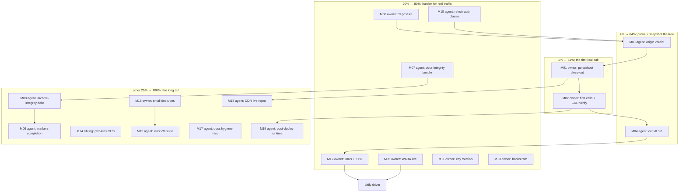

# Pareto Plan — First Call to Daily Driver (round 11, 2026-10-12 05:47)

> **Input:** `TODO_LIST.md` at 2026-10-12 05:47 (22 open rows: 1 High, 12
> owner-Blocked, 1 Medium, 8 Low) + docs-health round-10 §f (24 items) +
> FEATURES `PARTIALLY_FUNCTIONAL`/`PLANNED` rows + ROADMAP open questions
> 6/8/9/10. New since round 10: the webphone relock `db741fd0` landed
> attributed (ritual proven to the browser gate), `markers_check` gained
> the ID-header fix, upstream is mid-wave on unified auth, and origin CI
> is waiting for its first post-attribution verdict. **Destination:**
> unchanged since round 1 — the stack carries the owner's real calls as
> the daily driver. Point-in-time snapshot: annotate, never rewrite.
> M-rows in Step 2 are marker-gate scoped; Step-3 fine rows inherit
> their M-row verdicts.

## Step 1 — Pareto breakdown

### The 1% that delivers 51%: ONE task

**M01+M02 — the owner's first real call.** Every suite, module, guard
and doc in this repo exists so `pbx.artmann.tech` can place and receive
the owner's calls. The portal/host close-out converts "CI-proven" into
"carrying traffic"; nothing else on this list changes the project's real
state. (Round 10 said it; the tree is now MORE proven — relock ritual
green to the browser gate — so the only remaining gap is owner hands-on
steps.)

### The 4% that deliver 64%: +2 tasks

- **M03 — origin verdict over the attributed tree.** Today's relock
  attribution + gate fix + docs round are committed locally; the two
  in-flight origin runs predate the fix and will fail lock-guard by
  birth. The next completed run is the trust anchor for deploying HEAD.
- **M04 — cut v0.3.0.** `[Unreleased]` now holds the WhatsApp lane, the
  agent, three attributed relocks and round 10; the release is the
  rollback anchor the first call should land on.

### The 20% that deliver 80%: +7 tasks

- **M06 — CI posture: branch protection + notification** (owner; three
  unnoticed-red incidents in two weeks — the packet sits ready in
  `docs/ci-posture.md`)
- **M07 — docs-integrity bundle: pytest module + archive-time checklist
  gate + SKILLS note** (this week proved the marker gates need test
  coverage and mechanical annotate→gate→move ordering)
- **M05 — WABA live verification** (owner; the WhatsApp lane becomes
  real)
- **M12 — Warsaw DID + KYC + DE DID** (owner; actual numbers to call)
- **M11 — Telnyx API-key rotation** (owner; pre-real-traffic hygiene)
- **M13 — global hooksPath landmine** (owner machine; every ungated repo
  on it runs hooks from nowhere)
- **M10 — relock auth-surface clause** (upstream auth wave → the next
  relock must diff the `/config.js`/login contracts this repo pins)

### The other 20% (to 100%): the long tail

M08 (archive-integrity debt), M09 (markers completion batch), M14
(pbx-lens sibling CI fix), M15 (telephony-lens VM suite), M16 (owner
small decisions incl. fspbx sign-off, lens vhost, OQ6/OQ8), M17 (docs
hygiene misc), M18 (CDR cancelled-leg live repro — needs the live host),
M19 (post-deploy runtime verifications). None block the first call; all
raise the floor.

## Step 2 — Comprehensive plan (30–100 min tasks, 19 total)

Sorted by importance / impact / effort / customer-value. Owner-lane
tasks are marked; the agent can execute every other row.

| ID  | Task (30–100 min)                                                                                                                                                             | Lane    | Impact   | Effort   | Source row(s)                     |
| --- | ------------------------------------------------------------------------------------------------------------------------------------------------------------------------------ | ------- | -------- | -------- | ---------------------------------- |
| M01 | First-call close-out, portal/host: PATCH messaging-profile webhook URL, close the outbound-call loop, re-add static IPv6 + AAAA, delete the old billing server, run deploy.md §5, trunk hardening (Telnyx CIDRs + fail2ban), Hetzner firewall + ssh-audit pass | owner   | Critical | 100min   | High deployment row                |
| M02 | First real calls both directions + CDR rows + webphone History verify (deploy.md §5 checklist on the live host)                                                                | owner   | Critical | 30min    | High deployment row                |
| M03 | Origin verdict over the attributed tree: confirm the relock attribution + gate fix are pushed, watch the next completed run, read it airtight, record evidence in the TODO rows  | agent   | Critical | 30-60min | round-10 §f.1; relock attribution  |
| M04 | Cut v0.3.0: date `[Unreleased]`, finalize entries, tag, `gh release create`, repo metadata refresh (owner timing gate)                                                          | agent   | High     | 30min    | v0.3.0 row                         |
| M06 | CI posture: branch protection + required checks or minimum failure notification, applied from the docs/ci-posture.md packet                                                     | owner   | Critical | 30min    | CI-posture row                     |
| M07 | Docs-integrity bundle: markers arms into a pytest module (incl. the ID-header regression arm), one archive-time checklist script (annotate → gate → move), SKILLS-repo attribution note | agent   | High     | 100min   | 3 Low rows + round-10 §f.20        |
| M05 | WABA live verification: embedded signup, VOICE OTP, `messaging.whatsapp.{enable,did}` on the live host, round trip both directions incl. media                                  | owner   | High     | 60min    | WhatsApp owner row                 |
| M12 | Warsaw DID re-purchase + 5 KYC requirements inside the ~48h window + DE national DID order                                                                                      | owner   | High     | 40min    | Warsaw DID row                     |
| M11 | Rotate the Telnyx API key + update the scrub-pattern prefix in the same action                                                                                                  | owner   | Medium   | 30min    | key-rotation row                   |
| M13 | Fix the global `~/.gitconfig core.hooksPath` landmine at home-manager level + heal this repo's hook + canary re-test                                                            | owner   | Medium   | 30min    | hooksPath row                      |
| M10 | Relock auth-surface clause: ops-runbook gate-5 wording + a contract-diff checklist for `/config.js` and the login DOM before the next relock                                    | agent   | Medium   | 30min    | auth-diff row (new)                |
| M08 | Archive-integrity debt: residual rendering sweep of all 75 archived snapshots (audit script + fix pass), docs/lessons/ formatter entry (+ mechanism-deviation note), AGENTS marker-paragraph slim, DOMAIN_LANGUAGE vocab | agent   | Medium   | 100min   | 4 Low rows                         |
| M09 | markers_check completion batch: per-item monotonicity arm, docstring evasion classes + exit-code parity, incident-triangle + split-brain audits                                 | agent   | Medium   | 90min    | 3 Low rows                         |
| M14 | pbx-lens sibling: fix the cqrs-lint install (go-cqrs-lite module-path casing at the pinned rev) in its CI workflow, verify green                                                | sibling | Medium   | 30min    | round-10 §f C.20                   |
| M15 | telephony-lens VM suite: service up, poll cadence, index registered in `state.*`, snapshot staging asserted (webphone-suite pattern)                                            | agent   | Medium   | 100min   | FEATURES lens row gap              |
| M16 | Owner small-decisions batch: browser E2E promotion, mainProgram policy, sops example host, GitHub residual appetite, scrub placeholders, lens vhost, fspbx sign-off + execute, OQ6 qemuGuest, OQ8 binfmt | owner   | Low      | 60min    | 5 blocked rows + 2 OQs + fspbx     |
| M17 | Docs-hygiene misc: counts-derivation spike (test/check counts as a drift arm instead of hand-maintained) + round-11 scoping for the 17 October reports                          | agent   | Low      | 45min    | round-10 §f.13/§f.C.23             |
| M18 | CDR cancelled-leg reproduction on the live host: journal a cancelled mid-ring call, check `uuid_dump` CDR vars, decide the honest fix (gated on M01/M02)                        | agent   | Medium   | 60min    | CDR Medium row                     |
| M19 | Post-deploy runtime verifications: TURN-over-TLS exercised with the real cert, real-ITSP gateway validation pass (gated on M02)                                                 | agent   | Low      | 60min    | FEATURES PARTIAL rows              |

## Step 3 — Fine breakdown (≤12 min per task, 73 tasks)

Fine rows inherit their M-row verdict (house convention). Sorted by
parent priority, then execution order inside the parent.

| ID  | Task (≤12min)                                                          | Parent | Value |
| --- | ----------------------------------------------------------------------- | ------ | ----- |
| F01 | PATCH the messaging-profile webhook URL in the Telnyx portal            | M01    | High  |
| F02 | Close the outbound-call loop: CC app + outbound profile settings        | M01    | High  |
| F03 | Re-add static IPv6 + AAAA record (probe showed AAAA absent)             | M01    | High  |
| F04 | Delete the old (billing) server                                         | M01    | High  |
| F05 | Run the deploy.md §5 checklist paste-pack on the live host              | M01    | High  |
| F06 | Trunk hardening: Telnyx source CIDRs into `allowedCidrs`                | M01    | Med   |
| F07 | fail2ban posture check on the live host                                 | M01    | Med   |
| F08 | Apply the Hetzner Cloud Firewall per docs/security.md                   | M01    | Med   |
| F09 | One `ssh-audit` triage run                                              | M01    | Med   |
| F10 | First real calls, both directions                                       | M02    | High  |
| F11 | Verify CDR rows + webphone History for those calls                      | M02    | High  |
| F12 | Record the milestone (CHANGELOG/FEATURES if the shape changed)          | M02    | Med   |
| F13 | Confirm the relock attribution + gate fix commits are pushed            | M03    | High  |
| F14 | Watch the next origin run to a COMPLETED verdict (rerun if runner-cancelled per protocol) | M03  | High  |
| F15 | Read the run airtight, record the verdict in the TODO row evidence      | M03    | Med   |
| F16 | Date `[Unreleased]`, finalize the section entries                       | M04    | Med   |
| F17 | Tag `v0.3.0` + `gh release create`                                      | M04    | Med   |
| F18 | Repo metadata refresh check                                             | M04    | Low   |
| F19 | Draft the branch-protection settings (required-checks list)             | M06    | High  |
| F20 | Wire failure notification (badge/email per the packet)                  | M06    | High  |
| F21 | Apply protection after owner sign-off                                   | M06    | High  |
| F22 | Port the markers self-test arms into the pytest module                  | M07    | High  |
| F23 | Add the ID-header regression arm (`\| ID \|` rows must stay excluded)   | M07    | High  |
| F24 | Write the archive-time checklist script (annotate → gate → move)        | M07    | Med   |
| F25 | Wire pytest module + checklist into flake checks with negative arms     | M07    | Med   |
| F26 | SKILLS-repo hand-authored attribution note for the `r` kind             | M07    | Low   |
| F27 | Meta Business Manager embedded signup via the Telnyx portal             | M05    | High  |
| F28 | Number verification via VOICE OTP (SMS-to-VoIP is "Not Recommended")    | M05    | High  |
| F29 | Set `messaging.whatsapp.{enable,did}` on the live host + rebuild        | M05    | High  |
| F30 | Round trip both directions incl. media                                  | M05    | High  |
| F31 | Warsaw DID re-purchase in the portal                                    | M12    | Med   |
| F32 | Submit the 5 KYC requirements inside the release window                 | M12    | Med   |
| F33 | DE national DID order                                                   | M12    | Med   |
| F34 | Generate the new Telnyx API key in the portal                           | M11    | Med   |
| F35 | Update the key consumers (scripts/secrets)                              | M11    | Med   |
| F36 | Update the scrub-pattern prefix + scrub-check run                       | M11    | Med   |
| F37 | home-manager: real global hooks dir or drop `core.hooksPath`            | M13    | Med   |
| F38 | Heal this repo's hook + canary re-test                                  | M13    | Med   |
| F39 | ops-runbook gate-5 row: name the auth/config surface diff               | M10    | Med   |
| F40 | Write the contract-diff checklist (`/config.js` keys, login DOM)        | M10    | Med   |
| F41 | Write the residual rendering-audit script (fences, emphasis damage)     | M08    | Med   |
| F42 | Run the sweep over all 75 archived snapshots; fix what it finds         | M08    | Med   |
| F43 | Write the docs/lessons/ formatter-over-archives entry                   | M08    | Med   |
| F44 | Fold the mechanism-deviation note (pickaxe → follow+count) into it      | M08    | Low   |
| F45 | Slim the AGENTS.md marker-convention paragraph to point at the lesson   | M08    | Low   |
| F46 | Monotonicity vocabulary into DOMAIN_LANGUAGE                            | M08    | Low   |
| F47 | Implement the per-item monotonicity arm (row-level counts)              | M09    | Med   |
| F48 | Self-test arms for the per-item arm                                     | M09    | Med   |
| F49 | Document the count-metric evasion classes in the docstring              | M09    | Low   |
| F50 | Exit-code parity: docstring 0/1/2 ↔ `--help` text                       | M09    | Low   |
| F51 | Incident-triangle check for archive incidents #1/#2                     | M09    | Low   |
| F52 | Docstring-vs-AGENTS split-brain audit                                   | M09    | Low   |
| F53 | pbx-lens: pin/fix the cqrs-lint rev (module-path casing) in CI          | M14    | Med   |
| F54 | Verify the pbx-lens CI run goes green                                   | M14    | Med   |
| F55 | Scaffold the lens test fixture (service + empty index)                  | M15    | Med   |
| F56 | Drive the poll cadence + one ingest arm in-VM                           | M15    | Med   |
| F57 | Assert `state.*` registration + snapshot staging                        | M15    | Med   |
| F58 | Green the suite + wire the flake check                                  | M15    | Med   |
| F59 | Browser E2E promotion decision (periodic/per-push/lock-triggered)       | M16    | Low   |
| F60 | flake-meta-checker mainProgram policy decision                          | M16    | Low   |
| F61 | sops-nix example host go/no-go                                          | M16    | Low   |
| F62 | GitHub residual-exposure decision (support GC vs accept)                | M16    | Low   |
| F63 | Scrub placeholders: fill or delete the three                            | M16    | Low   |
| F64 | Lens vhost decision (expose UI vs loopback + tunnel)                    | M16    | Low   |
| F65 | fspbx verdict sign-off + execute (revoke PAT, stop VM, trash/relocate)  | M16    | Low   |
| F66 | OQ6 qemuGuest on prod: decide                                           | M16    | Low   |
| F67 | OQ8 aarch64 binfmt on evo-x2: decide                                    | M16    | Low   |
| F68 | Counts-derivation spike (derive test/check counts for the drift arm)    | M17    | Low   |
| F69 | Round-11 docs-health scoping: inventory the 17 October reports          | M17    | Low   |
| F70 | Journal a cancelled mid-ring call on the live host                      | M18    | Med   |
| F71 | Check `uuid_dump` CDR vars + record the source-level verdict            | M18    | Med   |
| F72 | TURN-over-TLS runtime check with the real certificate                   | M19    | Low   |
| F73 | Real-ITSP gateway validation pass on the live trunk                     | M19    | Low   |

## Execution graph (mermaid)

Critical path: **M03 → M01 → M02 → M04 → M12** (verdict the tree, close
out the host, place the calls, snapshot the release, get real numbers).
Everything in the 20% tier hangs off that path and can run interleaved;
the tail is floor-raising, never blocking.

## Provenance

- Source: `TODO_LIST.md` (22 open rows at 05:47), docs-health round-10
  report §f (24 items), FEATURES `PARTIALLY_FUNCTIONAL`/`PLANNED` rows,
  ROADMAP OQ6/8/9/10, and this session's finds: the attributed
  `dffdb5f → db741fd0` relock, the markers ID-header fix, the upstream
  unified-auth wave (plan dated 2026-10-12 upstream), and the sibling
  pbx-lens CI red.
- No new tasks were minted beyond what a source row already owns; the
  plan is the snapshot, TODO_LIST is the living source.
- Verschlimmbesserung guard: no speculative rewrites; every change must
  leave the plan and the repo verifiably no worse than found. The gate
  battery (markers 77/0, drift, lock-guard) must stay green after this
  file lands.
