# SUPERB: CI trust + truth-hygiene Pareto plan — 2026-11-07 09:15

**Trigger:** the 2026-11-07 docs-health round 11 (`docs/status/2026-11-07_09-07_…`,
commit `55fd122`): the corpus debt is gone (zero loose snapshots, 29 archived, ~35
routed TODO rows), the health report scored the as-found state Accuracy 4.75 /
Fitness 8.5, and the CI main gate is RED ×3. This plan converts the entire routed
backlog into an executable train.

**Facts on the ground at planning time:**

- `nix flake check` job RED ×3 on main (2026-11-06 21:44 → 2026-11-07 03:34, latest
  failing head `0b4ce0c`): the main job fails while aarch64 VM + stdlib python suites
  pass — a real red, not an infra cancel. The failed STEP log has never been read.
- Last recorded GREEN main verdict: run `38213939150` over `3b63222` (2026-10-12,
  round-11 era). Nearly four weeks of partial verdicts since.
- The `5f331e6` CHANGELOG entry overclaims "full `nix flake check`" at that pin (the
  producing session's own §d1 admission); the append-only correction is unpaid.
- Lagging non-webphone inputs: `flake-parts_2` ~3 commits behind its tip,
  `home-manager` at a 2026-09-18 rev — the monthly bot never completed (owner toggle).
- The mystery sweep executor (unattributed `nix flake update` runs) is still
  unidentified; only containment (lock-move-guard) shipped.
- Gate-4 anomaly: `telephony-webphone` passed at a pin whose binary serves a key the
  suite's assert rejects — eval-cache vs ordering subtlety, unresolved.
- pbx-lens upstream CI failing (run `42162572870`: cqrs-lint, Build & Test, Lint,
  Vulnerability Check); this repo consumes that input's flake.
- TODO_LIST after the harvest: ~45 rows, gates green, corpus archived. No loose work.

**Errata (stale-backlog corrections, per the planning skill's Step 0):**

- The "vulture whitelist missing" route from the sweep was FALSE —
  `tests/vulture_whitelist.py` exists (AGENTS.md was right). No row minted.
- `serverTiming` stays owner-YAGNI'd (2026-10-26 decision) — not re-planned.
- T12 metrics card / T13 retentionDays / first-deployment close-out: already
  TODO_LIST owner rows — enumerated below, not re-planned.
- Both prior SUPERB plans (2026-10-01, 2026-10-07) verified fully executed during
  round 11 — nothing re-dispatched from them.

**Decision defaults encoded (owner may override at the gates):**

- CI heal precedes everything: no relock, no release, no feature merge claims while
  the main gate is red.
- CHANGELOG corrections append to the existing entry; never rewrite history.
- No lock move during a red main; lock moves stay hand-authored per the ritual.
- Grab-bag TODO rows split per lane the first time they are touched.
- The native doc gates (markers/rendering/drift) stay until the docs-gates adoption
  question (§g3 of the status report) is answered.

---

## Pareto breakdown

### The 1% that delivers 51%

**M01 — Heal the CI main gate.** One failing check blocks every verdict claim in
the repo: releases, relocks, feature trains all ride `nix flake check`. Read the
failed step log, fix, push, capture the airtight green.

### The 4% that deliver 64%

- **M01** (above)
- **M02 — Honesty-debt sweep** (`5f331e6` correction, `c59305ba`/`c19bdea`
  backfills, CDR row compression, deploy.md timeZone): the docs tell the truth
  again for ~40 minutes of work.
- **M03 — Lagging-input refresh**: `flake-parts_2` + `home-manager` current; eval
  green.
- **M04 — Full-check green re-proof**: one airtight green over a current head,
  recorded — the first complete verdict since 2026-10-12.

### The 20% that deliver 80%

- **M05 — Relock ladder automation** (`relock-ladder.sh`): removes the manual
  bookkeeping that produced the overclaim class.
- **M06 — Gate-4 anomaly archaeology**: closes the eval-cache question with one
  `--no-eval-cache` rerun.
- **M07 — Runbook ritual hardening** (twelve sub-items a–l): the gate table
  becomes current.
- **M08 — Nonce knowledge capture**: the 2026-10-26 dialplan root cause + harness
  land in the lessons instead of dying with session reports.
- **M09 — Process-rule codification**: ~20 swept rules into AGENTS.md/lessons.
- **M10 — AGENTS.md trim**: ~560 lines down to the durable core.

### The other 20% (to reach 100%)

- **M11–M21**: small-tooling batch, pre-commit hardening, test depth, cross-repo
  lanes (webphone/pbx-lens/crush-config), sweep-executor hunt, ops docs, passkey
  ceremony lane, ops singles, messaging depth, CI topology.
- Owner-gated lanes (enumerated, not planned — not agent-executable): fspbx
  sign-off + Sanctum PAT revocation; Warsaw DID + KYC; Telnyx key rotation (+ scrub
  pattern update); scrub-pattern placeholders; browser E2E CI promotion gating;
  sops-nix example host; GitHub residual-exposure appetite; the global
  `core.hooksPath` landmine; branch protection + required checks; WhatsApp live
  WABA verification; lens UI vhost decision; ALERT_WEBHOOK fire-drill; T12 `/metrics`
  consumer card; T13 `retentionDays` facade; push-seam scope; ASR provider decision;
  `a0c78ca` history surgery; stale `chore/flake-update-2026-09` branch deletion;
  the flake-update bot Actions toggle.
- ROADMAP raw ideas (not refined into tasks): webphone staleness alarm, upstream
  bulk-commit split proposal, serialized CI VM checks, round-12 folding +
  provenance note, nixpkgs lock fencing, M12 summarize-button pin, voicemail depth
  family (quotas/greeting/MWI/PSTN/DB-backup/PIN damper), plus everything already
  on ROADMAP (DISA, IVR nesting, Kamailio spike, IPv6 profiles, upstreaming, …).

---

## Step 2 — comprehensive plan (medium granularity, 30–100 min)

Sorted by importance / impact / effort / customer-value. Order = execution order.

| #   | Task                                                                                                                                                                                                                                                                              | Impact     | Effort | Customer value / why this order                                                                                        |
| --- | --------------------------------------------------------------------------------------------------------------------------------------------------------------------------------------------------------------------------------------------------------------------------------- | ---------- | ------ | ---------------------------------------------------------------------------------------------------------------------- |
| M01 | **CI main-gate heal**: read the failed step log airtight (`gh run view`), reproduce the failing check locally, fix, fast gates, hand-authored commit, push, airtight green verdict                                                                                                  | Critical   | 60min  | Restores the verdict machinery everything else rides on; unblocks M04                                                   |
| M02 | **Honesty-debt sweep**: append the `5f331e6` overclaim correction; CHANGELOG backfills for `c59305ba` + `c19bdea`; compress the CDR TODO row; deploy.md `time.timeZone` note                                                                                                        | High       | 30min  | The docs tell the truth again; cheap, zero code risk                                                                    |
| M03 | **Lagging-input refresh**: update `flake-parts_2` + `home-manager`; `--no-build` eval green; CHANGELOG rev entry; commit                                                                                                                                                            | Medium-High | 30min  | Restores the monthly refresh contract the dead bot left behind                                                           |
| M04 | **Full-check green re-proof**: single monitored `nix flake check` launch over the healed head, verdict recorded in CHANGELOG + TODO row, push + origin verdict                                                                                                                     | High       | 100min | First complete green verdict since 2026-10-12; every later claim rides it                                               |
| M05 | **Relock ladder automation**: `scripts/relock-ladder.sh` — gate list, per-gate verdict capture, `NIX_EXIT` discipline, dry-run against the current pin, AGENTS/runbook pointers                                                                                                     | Medium     | 60min  | Kills the manual-bookkeeping overclaim class at its root                                                                 |
| M06 | **Gate-4 anomaly archaeology**: rerun `telephony-webphone` at the `5f331e6` base lock with `--no-eval-cache`; record the verdict (eval-cache class vs ordering bug) in AGENTS/lessons; close the TODO row                                                                            | Medium     | 30min  | Closes a known-open correctness question; validates the staleness-check theory                                                          |
| M07 | **Runbook ritual hardening**: gate-5 selector inventory + gate-0 prove-before-lock + `--no-eval-cache` note + `afcd2d5` shape + gate-4 names + `--update-input` syntax + ordering notes + pre-drafted CHANGELOG step + pointer lines + battery-regen + shutdown notes (sub-items a–l) | High       | 45min  | The runbook becomes the single current home for the ritual — heals the documented split brains                           |
| M08 | **Nonce knowledge capture**: freeswitch.md nonce-store mechanics; the nonce-deleter harness in-repo; vm-testing lessons (custom-driver recipe, busy-spin/`_parse_one`/py_compile/tail-truncation, empty-output/nix-log, OOM, eval-cache serialization)                               | Medium     | 60min  | The 2026-10-26 root-cause knowledge outlives the session reports; the harness stops dying in /tmp                        |
| M09 | **Process-rule codification**: ~20 swept rules into AGENTS.md clusters + lessons long-forms, deduplicated per one-home-per-fact                                                                                                                                                     | Medium     | 60min  | Future sessions inherit the discipline instead of re-deriving it                                                         |
| M10 | **AGENTS.md trim**: inventory 560 lines, move duplicates to their owning files, cut confirmed duplicates, re-verify coverage                                                                                                                                                        | Medium     | 60min  | The durable-context file stays load-bearing instead of accreting forever                                                 |
| M11 | **Small-tooling batch**: lock-doctor retry + target-rev verdict; configjs `agent is False` pin; csrf eval arm; doc-counts check; TRACKED_INPUTS shared module; DOMAIN_LANGUAGE vocabulary                                                                                             | Medium     | 60min  | Six bounded seeds from the sweep, one session, all behind existing gates                                                 |
| M12 | **Pre-commit/lock-gate hardening**: hook self-heal regression script; lock-move canary script; lock-move-guard drv arm swap; commit-msg check counterpart; heal-script canary; mypy `check-untyped-defs` ladder                                                                       | Medium     | 60min  | The gate infrastructure gets its own regression nets — the guards guard themselves                                        |
| M13 | **Test depth lane 1**: sip.py re-auth unit test; ended-card content assert; textagent 503 log assert; livez/startupz asserts; missed-call ring shape; cdr-visibility row-shape assert                                                                                               | Medium     | 60min  | The suites pin contracts they currently only imply                                                                       |
| M14 | **Cross-repo lane**: verify + file the webphone listener-bind-order issue; refresh upstream "Browser E2E" FEATURES row; crush-config lessons entries                                                                                                                                 | Low-Medium | 60min  | The consumer contracts get fixed at the source, not worked around here                                                    |
| M15 | **(repo: pbx-lens) upstream CI heal**: read the four failing jobs, fix, push, green verdict, cross-verify this repo's eval at the new rev                                                                                                                                            | Medium     | 60min  | The sibling repo's gate means something again; this repo's input rides it                                                 |
| M16 | **Sweep executor hunt**: scheduler/timer inventory, canary sentinel + audit instrumentation, log correlation, AGENTS forensics update, close-or-convert the row                                                                                                                      | Medium     | 60min  | The only unresolved incident class from the lock-sweep era                                                                |
| M17 | **Ops docs lane**: pbx-lens runbook subsection; providers re-verification pass (dated); browser-render both deep-dive HTMLs; demo-VM Berlin wall-clock smoke                                                                                                                        | Low-Medium | 60min  | The operator-facing docs and evidence renders catch up with the shipped state                                              |
| M18 | **Passkey ceremony lane**: CDP virtual-authenticator harness; passkey ceremony E2E; enroll wrapper unit; secrets.md note; theme-only E2E variant; pbx-prod CHANGEME prep; suite runs                                                                                               | Medium     | 100min | The passkey lane gets browser-level proof; prod enablement becomes a fill-in not a project                                 |
| M19 | **Ops-singles lane**: mailbox quota options; MWI provisioning check; voicemail greeting surface; status-answer helper; pipefail guidance; buildflow doctor follow-up; attribution store sharing; post-deploy smoke recipe                                                             | Low        | 100min | Ten swept singles cleared in one pass                                                                                      |
| M20 | **Messaging depth batch**: WhatsApp media in-VM arm; `.chan-mms` badge CSS; portal 40008 wording pin; suite + commit                                                                                                                                                                | Low        | 45min  | The WhatsApp lane's visual/test gaps close                                                                                |
| M21 | **CI topology batch**: `--system` sentinel guard; cross-arch eval job split; weekly red-gate canary; per-arch eval timings; aarch64 webphone build proof; E2E runner user unit                                                                                                      | Low-Medium | 60min  | The CI failures get faster to triage and harder to misread                                                                 |

21 tasks, every agent-executable TODO covered, none over 100 min. Owner-gated lanes
and ROADMAP raw ideas are enumerated above, not planned.

---

## Step 3 — fine breakdown (max 12 min per task)

Fine rows inherit their parent task's verdict and stay bare by the markers
convention (AGENTS.md). "Suite" steps are single monitored launches; triage/fix is
always a separate step. Sorted by execution order (= the table above).

| #   | Step                                                                                                                                                        | Est | Verify via                                      |
| --- | ----------------------------------------------------------------------------------------------------------------------------------------------------------- | --- | ----------------------------------------------- |
| 1   | Read the failing job's step log airtight (`gh run view <id> --job`, failed check name + log tail)                                                           | 12m | log excerpt                                     |
| 2   | Reproduce the failing check locally (`nix build .#checks.x86_64-linux.<name>`, `NIX_EXIT` captured)                                                          | 12m | local rc                                        |
| 3   | Fix the failing check (the minimal honest fix — no assertion loosening without a recorded reason)                                                           | 12m | diff                                            |
| 4   | Fast gates: `nix fmt` + `telephony-eval` + markers/rendering/drift                                                                                          | 12m | green                                           |
| 5   | Hand-authored commit naming the failing check + the root cause                                                                                              | 5m  | `git log -1`                                    |
| 6   | Push + airtight origin verdict (`gh run view`, cancel ≠ red protocol)                                                                                       | 12m | CI verdict                                      |
| 7   | Append the `5f331e6` overclaim correction to the existing CHANGELOG entry                                                                                   | 5m  | doc review                                      |
| 8   | CHANGELOG backfill: the `c59305ba` lock-move attribution entry                                                                                              | 10m | doc review                                      |
| 9   | CHANGELOG backfill: the `c19bdea` CI-fix entry                                                                                                              | 5m  | doc review                                      |
| 10  | Compress the CDR TODO row to a bounded row + evidence pointer                                                                                               | 12m | drift gate                                      |
| 11  | deploy.md: `time.timeZone` in the operator CHANGEME walk                                                                                                    | 5m  | doc review                                      |
| 12  | Gates: markers + rendering + drift + fmt                                                                                                                    | 5m  | green                                           |
| 13  | `nix flake update` the lagging inputs (`flake-parts_2`, `home-manager`)                                                                                     | 5m  | `flake.lock` diff                               |
| 14  | `nix flake check --no-build` eval green at the refreshed lock                                                                                                | 12m | eval rc                                         |
| 15  | CHANGELOG rev entry + hand-authored commit (non-tracked inputs, guard not required — entry still owed)                                                       | 10m | `git log -1`                                    |
| 16  | Verify HEAD state post-M01–M03 (clean tree, log sanity)                                                                                                     | 5m  | `git status`                                    |
| 17  | Launch `nix flake check` (single monitored launch, `NIX_EXIT=$?` captured, log tee'd)                                                                       | 12m | launch + tee file                               |
| 18  | Monitor to completion; triage any red at its own check (no batch-fixing)                                                                                    | 12m | per-check verdicts                              |
| 19  | Record the verdict: CHANGELOG CI entry + TODO row update (the re-proof row closes)                                                                          | 10m | doc review                                      |
| 20  | Push + airtight origin verdict; on cancel, read step timestamps before calling it infra                                                                      | 12m | CI verdict                                      |
| 21  | Design `relock-ladder.sh`: gate list, per-gate verdict capture, exit-code contract                                                                          | 12m | design note in the script header                |
| 22  | Write the script: `set -euo pipefail`, `NIX_EXIT` discipline, per-gate tee'd logs                                                                           | 12m | shellcheck                                      |
| 23  | Encode the gate set (binary build, fast gates, suites list, browser E2E flag, full-check flag)                                                              | 12m | dry-run                                         |
| 24  | Dry-run the ladder against the CURRENT pin (no lock move — gate-list sanity)                                                                                | 12m | per-gate verdicts                               |
| 25  | AGENTS.md pointer + runbook gate-0 cross-reference                                                                                                          | 10m | doc review                                      |
| 26  | Commit                                                                                                                                                      | 5m  | `git log -1`                                    |
| 27  | Worktree at the `5f331e6` base lock; rerun `telephony-webphone` with `--no-eval-cache`                                                                      | 12m | suite rc                                        |
| 28  | Verdict: green → eval-cache class confirmed; red → ordering-bug hunt (separate follow-up)                                                                   | 12m | recorded verdict                                |
| 29  | Record in AGENTS/lessons + close the TODO row                                                                                                               | 5m  | doc review                                      |
| 30  | Gate-5 selector inventory += `.wp-ended-card` / `.close-ended-btn`                                                                                          | 5m  | doc review                                      |
| 31  | Gate-0 prove-before-lock row in the gate table (build the exact rev BEFORE the lock move)                                                                   | 10m | doc review                                      |
| 32  | `--no-eval-cache` note after any lock move (the stale-check class)                                                                                          | 5m  | doc review                                      |
| 33  | Daemon-swept-BOTH-inputs shape (`afcd2d5`): attribution entries must heal all arms                                                                          | 10m | doc review                                      |
| 34  | Gate-4 check names current + `--update-input` syntax refresh + newer-tip note + gate-2-before-gate-1 + stale-rev grep step                                   | 12m | doc review                                      |
| 35  | Pre-drafted CHANGELOG relock step + AGENTS pointer line + recursive-update lane docs + battery-regen note + graceful-shutdown note                            | 12m | doc review                                      |
| 36  | freeswitch.md: nonce-store mechanics section (sqlite `sip_authentication`, `last_nc`, `stale=true`, races, nonce-ttl knob)                                    | 12m | doc review                                      |
| 37  | Salvage the nonce-deleter harness from the round report into `tests/`/`scripts/`                                                                            | 12m | file + runnable                                 |
| 38  | vm-testing.md: custom-driver recipe (`--test-script`, driver-drv discovery, epoch-mtime `ls -dt` trap)                                                        | 12m | doc review                                      |
| 39  | vm-testing.md: busy-spin / `_parse_one` / py_compile / tail-truncation lessons                                                                               | 12m | doc review                                      |
| 40  | vm-testing.md: empty-output / nix-log reading + OOM local-vs-CI + eval-cache serialization                                                                    | 12m | doc review                                      |
| 41  | Commit + cross-link the lessons                                                                                                                             | 5m  | `git log -1`                                    |
| 42  | AGENTS cluster 1: fail-loudly gate composition, same-window changelog bookkeeping, read-only probe discipline                                                | 12m | doc review                                      |
| 43  | AGENTS cluster 2: lane-probe + grep-twins, verification-neutral messages, workflow-filter verdict rule, gh default-repo drift note                            | 12m | doc review                                      |
| 44  | AGENTS cluster 3: evidence-tier tags, treefmt race caution, session-start lane ladder, daemon commit review ritual                                           | 12m | doc review                                      |
| 45  | AGENTS cluster 4: unpiped exits, status mtime scan, sweep-source instrumentation, lock-guard FAIL shape, tee logging, stall tail, proof tiers, fresh-boot calibration | 12m | doc review                                      |
| 46  | Lessons long-forms: provenance labeling, recursive-update lane, attribution store sharing                                                                    | 12m | doc review                                      |
| 47  | Dedup per one-home-per-fact + drift/markers/fmt gates                                                                                                       | 10m | green                                           |
| 48  | Inventory the AGENTS 560 lines: mark duplicates-with-homes + stale claims                                                                                   | 12m | inventory list                                  |
| 49  | Move movable content to its owning files (FEATURES / runbook / lessons)                                                                                     | 12m | moved diffs                                     |
| 50  | Cut confirmed duplicates (round-trip the diff; nothing load-bearing lost)                                                                                   | 12m | diff review                                     |
| 51  | Re-verify the trimmed AGENTS covers session-durable needs (fresh-eyes read)                                                                                  | 10m | read                                            |
| 52  | Drift + markers + fmt gates                                                                                                                                 | 5m  | green                                           |
| 53  | Commit                                                                                                                                                      | 5m  | `git log -1`                                    |
| 54  | lock-doctor.py: retry/backoff on `gh api` timeouts                                                                                                          | 12m | forced-timeout test                             |
| 55  | lock-doctor.py: target-rev verdict mode (not just HEAD)                                                                                                     | 12m | flag + output                                   |
| 56  | configjs value-pin: `agent is False` (this stack wires no textagent seam)                                                                                   | 5m  | test rc                                         |
| 57  | csrf eval arm in `tests/eval.nix` (trusted_proxies/origins render facts)                                                                                    | 12m | eval rc                                         |
| 58  | doc-counts check wired into flake.nix (count drift fails the gate)                                                                                          | 12m | check rc                                        |
| 59  | TRACKED_INPUTS shared module (lock_guard.py + lock_move_hook.py import it)                                                                                   | 12m | both suites pass                                |
| 60  | DOMAIN_LANGUAGE vocabulary: base-attribution, enrollment token, usermgmt.db, prove-before-lock                                                               | 10m | doc review                                      |
| 61  | Eval + stdlib suites + gates + commit                                                                                                                       | 10m | green                                           |
| 62  | Hook self-heal regression script (`scripts/verify-hook-selfheal.sh`)                                                                                         | 12m | script + negative arm                           |
| 63  | Lock-move canary script (plant an unmarked move → guard blocks; marker → passes)                                                                            | 12m | both arms                                       |
| 64  | `lock-move-guard` drv runs `lock_move_hook.py`'s arms (currently `lock_guard.py`'s)                                                                          | 12m | check rc                                        |
| 65  | Commit-msg stage check counterpart (the hook lane runs it; the check lane does not)                                                                          | 12m | check rc                                        |
| 66  | Heal-script post-install canary (both stages present after heal)                                                                                            | 10m | script rc                                       |
| 67  | mypy `check-untyped-defs` ladder in `mypy.ini`                                                                                                              | 10m | mypy rc                                         |
| 68  | sip.py re-auth unit test in the stdlib lane (digest over the NEW nonce, bounded exhaustion)                                                                  | 12m | test rc                                         |
| 69  | Browser E2E: ended-card content assert (duration text, Close presence)                                                                                      | 12m | suite rc                                        |
| 70  | textagent suite: 503 bridge-log assert                                                                                                                      | 12m | suite rc                                        |
| 71  | livez/startupz suite asserts through the vhost                                                                                                              | 12m | suite rc                                        |
| 72  | Missed-call ring shape (tests/sip.py) honest-shape fix or recorded verdict                                                                                   | 12m | suite rc / verdict                              |
| 73  | cdr-visibility row-shape assert                                                                                                                             | 10m | suite rc                                        |
| 74  | Suite runs + gates + commit                                                                                                                                 | 12m | green                                           |
| 75  | Verify the listener-bind-order claim at the webphone source (imports vs serve order)                                                                        | 12m | source read                                     |
| 76  | File the upstream issue (verify-before-filing + github-voice)                                                                                               | 12m | issue URL                                       |
| 77  | Refresh the upstream "Browser E2E" FEATURES row (repo: webphone)                                                                                            | 12m | doc diff                                        |
| 78  | crush-config lessons.md entries (commit in that repo)                                                                                                       | 12m | commit                                          |
| 79  | Commit + push both repos as their lanes require                                                                                                             | 10m | `git log` both                                  |
| 80  | Read the pbx-lens failing runs (cqrs-lint / Build & Test / Lint / Vulnerability)                                                                            | 12m | log excerpts                                    |
| 81  | Fix cqrs-lint + build failures upstream                                                                                                                     | 12m | diffs                                           |
| 82  | Fix lint + vulnerability findings upstream                                                                                                                  | 12m | diffs                                           |
| 83  | Push + airtight green verdict                                                                                                                               | 12m | CI verdict                                      |
| 84  | Cross-verify this repo's eval at the new pbx-lens rev (+ lock-move attribution entry)                                                                       | 10m | eval rc + CHANGELOG                             |
| 85  | Scheduler/timer inventory round 2 (systemctl list-timers, cron, PMA config, shell profiles)                                                                  | 12m | inventory list                                  |
| 86  | Instrument: canary lock-rev sentinel + audit trail (who ran nix last)                                                                                        | 12m | sentinel artifact                               |
| 87  | Correlate sweep timestamps against daemon/pma/shell logs                                                                                                     | 12m | correlation note                                |
| 88  | Record findings in the AGENTS daemon forensics paragraph                                                                                                    | 10m | doc review                                      |
| 89  | Close or convert the sweep-executor TODO row                                                                                                                | 5m  | TODO diff                                       |
| 90  | pbx-lens runbook subsection (poll cadence, snapshot staging, retention purge, relock pattern)                                                                | 12m | doc review                                      |
| 91  | Providers re-verification pass part 1 (telnyx, didlogic: prices, KYC, lead times, date stamps)                                                              | 12m | doc diffs                                       |
| 92  | Providers re-verification part 2 (remaining files) + date stamps                                                                                            | 12m | doc diffs                                       |
| 93  | Browser-render the 2026-10-01 deep-dive HTML (dead-CSS check, addendum-only fixes)                                                                          | 10m | visual check                                    |
| 94  | Browser-render the 2026-10-07 deep-dive HTML                                                                                                                | 10m | visual check                                    |
| 95  | Demo-VM Berlin wall-clock smoke (`nix run .#vm`: webphone timestamps + ring window)                                                                          | 12m | probe output                                    |
| 96  | Commit                                                                                                                                                      | 5m  | `git log -1`                                    |
| 97  | CDP virtual-authenticator harness spike in `tests/browser-e2e.py`                                                                                            | 12m | harness rc                                      |
| 98  | Passkey ceremony E2E (create + login through the authenticator)                                                                                              | 12m | suite rc                                        |
| 99  | Webphone enroll wrapper unit test                                                                                                                           | 12m | test rc                                         |
| 100 | secrets.md passkey note                                                                                                                                     | 5m  | doc review                                      |
| 101 | Theme-only E2E variant                                                                                                                                      | 12m | suite rc                                        |
| 102 | pbx-prod passkey CHANGEME block prep (the fill-in shape, commented)                                                                                          | 10m | eval                                            |
| 103 | Passkey suites + gates                                                                                                                                      | 12m | green                                           |
| 104 | Commit                                                                                                                                                      | 5m  | `git log -1`                                    |
| 105 | Mailbox quota options (per-box quotas beside the recordings retention)                                                                                      | 12m | eval                                            |
| 106 | MWI provisioning check                                                                                                                                      | 10m | suite rc                                        |
| 107 | Voicemail greeting surface                                                                                                                                  | 12m | eval + suite                                    |
| 108 | Status-answer helper script                                                                                                                                 | 12m | script rc                                       |
| 109 | pipefail guidance in vm-testing.md                                                                                                                          | 5m  | doc review                                      |
| 110 | buildflow doctor follow-up                                                                                                                                  | 10m | findings note                                   |
| 111 | Attribution E2E store sharing note (evidence reuse across suites)                                                                                            | 10m | doc review                                      |
| 112 | Post-deploy browser smoke recipe + commit                                                                                                                   | 12m | recipe + commit                                 |
| 113 | WhatsApp media in-VM arm (tests/messaging.nix)                                                                                                              | 12m | suite rc                                        |
| 114 | `.chan-mms` badge CSS in operator.css                                                                                                                       | 10m | visual + suite                                  |
| 115 | Portal 40008 wording pin (replace the catch-all self-description)                                                                                            | 12m | test rc                                         |
| 116 | Messaging suite + gates + commit                                                                                                                            | 12m | green                                           |
| 117 | `--system` sentinel guard for the eval job (a stale/missing system answer fails loud)                                                                       | 12m | yaml + run                                      |
| 118 | Cross-arch eval job split                                                                                                                                   | 12m | yaml + run                                      |
| 119 | Weekly red-gate canary schedule (a deliberate red exercises notify-failure)                                                                                 | 10m | workflow run                                    |
| 120 | Per-arch eval timing capture (step-level durations surfaced)                                                                                                 | 10m | run output                                      |
| 121 | aarch64 webphone build proof (the binary builds on TCG arch too)                                                                                             | 12m | build rc                                        |
| 122 | E2E runner user unit + commit                                                                                                                               | 12m | unit + commit                                   |

122 steps, every agent-executable TODO covered, none over 12 min.

---

## Execution graph

```mermaid
flowchart TD
    P["Planning commit (this file)<br/>+ TODO_LIST already harvested (55fd122)"] --> M01
    subgraph ONE["1% → 51%"]
        M01["M01 CI main-gate heal<br/>log → repro → fix → airtight green"]
    end
    subgraph FOUR["4% → 64%"]
        M02["M02 honesty-debt sweep"]
        M03["M03 lagging-input refresh"]
        M04["M04 full-check green re-proof"]
    end
    subgraph TWENTY["20% → 80%"]
        M05["M05 relock ladder automation"]
        M06["M06 gate-4 archaeology"]
        M07["M07 runbook hardening"]
        M08["M08 nonce knowledge capture"]
        M09["M09 process codification"]
        M10["M10 AGENTS trim"]
    end
    subgraph REST["other 20% → 100%"]
        M11["M11 small-tooling batch"]
        M12["M12 pre-commit hardening"]
        M13["M13 test depth lane"]
        M14["M14 cross-repo lane"]
        M15["M15 pbx-lens upstream heal"]
        M16["M16 sweep-executor hunt"]
        M17["M17 ops docs lane"]
        M18["M18 passkey ceremony lane"]
        M19["M19 ops singles lane"]
        M20["M20 messaging depth"]
        M21["M21 CI topology"]
        OG["Owner-gated lanes +<br/>ROADMAP raw ideas<br/>(enumerated above)"]
    end
    M01 --> M02 --> M03 --> M04 --> M05
    M05 --> M06 --> M07 --> M08 --> M09 --> M10
    M10 --> M11 --> M12 --> M13 --> M14 --> M15 --> M16 --> M17 --> M18 --> M19 --> M20 --> M21
    M21 -.->|"owner lanes unchanged"| OG
```

## Gates map (what proves what)

- M01 → the failed check's local repro green + airtight origin verdict
- M02 → drift/markers/rendering/fmt green; the CHANGELOG entries present
- M03 → `nix flake check --no-build` eval green at the refreshed lock
- M04 → one completed `nix flake check` green + airtight origin verdict
- M05 → a dry-run ladder producing per-gate verdicts on the current pin
- M06 → a recorded verdict (whichever way it lands) in AGENTS/lessons
- M07–M10 → doc review + drift/markers/fmt green
- M11–M13 → eval rc + stdlib/suite rc green per step
- M14–M15 → upstream issue/PR URLs + airtight green verdicts
- M16 → a recorded forensic verdict (identified or ruled-out)
- M17–M20 → suite rc green + visual/doc checks
- M21 → workflow run green with the new topology
- Everything → `nix flake check` before each push; the local gate IS the finish line

## Verschlimmbessern guardrails

- No renames, no refactors, no new abstractions: every change is an option value,
  a script, a test assert, a doc paragraph, or one workflow stanza.
- The CI heal fixes the CHECK, never loosens the assertion — a recorded reason is
  required for any assert change.
- Lock moves stay out of this train entirely (M03 refreshes non-tracked inputs only);
  webphone/pbx-lens moves remain ritual-gated and hand-authored.
- CHANGELOG corrections append; history is never rewritten; the `a0c78ca` question
  stays an owner lane.
- Suite steps are single monitored launches; triage/fix is always a separate step.
- Gates FIRST after any nix/python edit (the daemon commits within minutes — the
  2026-10-26 race class); exit codes captured explicitly, never via `| tail`.
- Owner-BLOCKED TODO rows stay untouched; nothing here touches the live-deployment
  lane.

## Status

- Planning artifacts executed in this commit: this plan file. The round-11 sweep
  itself landed as `55fd122` (detailed message there).
- Execution NOT started — awaiting the "get shit done" go (skill: Full Execution
  Mode after approval).
