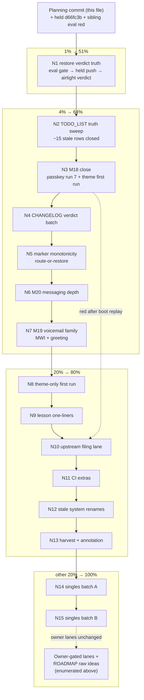

# SUPERB: verdict-truth + tails Pareto plan — 2026-11-08 08:53

**Trigger:** the 2026-11-08 08:44 status report
(`docs/status/2026-11-08_08-44_m18-m21-execution-m17-completion-ci-healed.md`,
commit `a49eb5c` + addendum `796739f`): the CI main gate is HEALED with
five airtight greens (the runner-starvation fix, `7ec6556` lineage),
M17 fully closed, M21 complete, M18/M19 partial — and the session
handed off on a red tree that is NOT its own: `checks.telephony-eval`
reds on the sibling nix-native-refactor head (clean-tree attribution
proven via stash run), seven marker-monotonicity findings ride the
sibling's sweep lane, `d66fc3b` sits held-unpushed, and TODO_LIST
carries ~15 rows this train's evidence already delivered. This plan
converts that handoff into an executable train: RESTORE VERDICT TRUTH
first, then finish the tails (M18 close, M19 voicemail family, M20
messaging depth), then the honest tail of the backlog.

**Facts on the ground at planning time:**

- CI: run `42436537760` (8342f2b8), `42436496246` (47a9f0f0),
  `42439341506`, `42438505651`, `42437708582` all completed success —
  the serialization topology (serialized check-vm pre-build + aggregate
  flake check) is proven 5/5. The pre-fix run `42434684049` red on the
  textagent 503-assert exactly as diagnosed; the pushed fix closed it.
- The sibling nix-native lane is ACTIVE (their `bc04f37` run
  `42458788528` in flight at planning time) and their eval red
  (`ringGroupDidToplevel`, proven NOT ours by a clean-tree stash run)
  is UNFIXED: `nix build .#checks.x86_64-linux.telephony-eval` exits 1
  on the current head at planning time.
- `markers_check.py` reports SEVEN monotonicity findings on three
  ARCHIVED snapshots (2026-10-07 ×2, 2026-10-28) — committed-history
  marker loss riding the sibling's 54-file sweep; the worktree is
  clean; remedy is restore-by-append in the owning lane.
- M18 passkey suite: three root causes fixed at source (ExecStart
  property-object `{`, verify-200/begin-503 projection race, passkey
  inline-secret scrutiny → authSecretFile), but run 6 STILL answered
  `user_not_found` at begin WITH the users_view wait green — the
  designed countermeasure (post-mint `webphone.service` restart, boot
  replay re-projects all events) is NOT yet run.
- M20 messaging depth, M19 MWI/greeting, and ~10 doc/single rows are
  untouched. `d66fc3b` (quota option + eval arm + passkey turn fix) is
  held-unpushed BEHIND the eval red.
- TODO_LIST carries stale rows this train's evidence closed: CI main
  gate RED ×3, full-check re-proof, providers re-verification, demo-VM
  wall-clock smoke, deep-dive renders, csrf eval arm, sip.py re-auth
  unit, livez/startupz asserts, DOMAIN_LANGUAGE vocabulary, lagging
  inputs refresh, sweep executor hunt, CI topology batch, passkey/test
  depth batch (most sub-items), webphone FEATURES row.

**Errata (stale-backlog corrections, per the planning skill's Step 0):**

- "CI main gate RED ×3" + "Full check re-proof": STALE — five airtight
  greens over `8342f2b8`/`47a9f0f0`+ lineages close M01 AND M04. Rows
  close in N2.
- "Providers re-verification pass": DONE 2026-11-07 (all nine provider
  files stamped; three research subagents + applied commits `3e8bdf7`,
  `d90993c`). Row closes.
- "Demo-VM Berlin wall-clock smoke": DONE as
  `legacyPackages.telephony-demo-wallclock` (SMOKE6-RC=0) — a
  re-runnable suite supersedes the one-shot `nix run .#vm` shape.
  Row closes.
- "Browser-render deep-dives": DONE (both render-inspected, CSS alive,
  zero dead classes; screenshots /tmp/render/, owner-visual lane
  remains). Row closes.
- "csrf eval-time arm", "sip.py re-auth unit", "livez/startupz
  asserts", "DOMAIN_LANGUAGE vocabulary", "lagging inputs refresh",
  "sweep executor hunt": all landed in the M01–M17 session (report
  `a49eb5c` §a). Rows close.
- "CI topology batch" (TODO row 70): DELIVERED (`e82ca47`: sentinel,
  timings, aarch64 proof, canary.yml, E2E runner user unit; the eval
  job split itself was the existing per-system shape). Row closes.
- "Passkey/test depth batch" (row 71): MOSTLY delivered — theme-only
  E2E code-complete (needs first run), passkey ceremony E2E code-
  complete (needs run 7), enroll wrapper VERIFIED upstream (5 island
  tests in enroll.test.mjs), secrets.md note landed, CHANGEME prep
  verified existing, quota option landed, store-sharing note
  pre-existing (operating.md §Attribution). Row REWRITES to the
  remainder (MWI, greeting, run 7).
- "(repo: webphone) Browser E2E FEATURES row": DONE (`b19cf624` in the
  webphone repo). Row closes.
- The upstream listener-bind-order issue (#238) row and the pbx-lens
  CI-heal row: closed yesterday; verified absent from TODO_LIST.

**Decision defaults encoded (owner may override at the gates):**

- The eval red is the SIBLING's lane first: diagnose + route before
  fixing. If their session is quiet (no push for 2h) and the fix is
  the minimal honest one, this train fixes it and says so in the
  commit — a red gate blocks every other verdict in this plan.
- The seven marker findings stay their lane UNLESS N1's diagnosis
  shows they block the gates this train needs; then restore-by-append
  with a commit naming the owning sweep.
- No lock moves; webphone/pbx-lens relocks stay ritual-gated.
- Suite launches carry the content check first (grep the marker the
  run must prove) — the run-4 waste class.
- Browser suites run SOLO; the new lanes (theme, passkey) stay
  on-demand legacyPackages until the owner promotes them.
- CHANGELOG corrections append; history is never rewritten.

---

## Pareto breakdown

### The 1% that delivers 51%

**N1 — Restore verdict truth.** The eval gate red + a stale TODO_LIST

- held work + unwritten verdicts together poison every future session's
  routing: fix/route the eval red, close the stale rows, push the held
  lane, write the CHANGELOG verdicts. One morning, and the repo's truth
  layer works again.

### The 4% that deliver 64%

- **N1** (above)
- **N2 — M18 close**: passkey run 7 (post-mint restart experiment) →
  suite green or upstream issue; theme-only suite first run → green.
- **N3 — M20 messaging depth batch**: WhatsApp media arm, .chan-mms
  badge CSS, 40008 wording pin; suite green.
- **N4 — M19 voicemail family**: MWI fsapi probe + dialplan assert;
  greeting recipe in the runbook.

### The 20% that deliver 80%

- **N5 — marker monotonicity restoration** (route-or-fix per the
  decision default).
- **N6 — AGENTS/runbook lesson one-liners** (ExecStart object,
  pipes-mask-rc pointer, RTC-as-UTC, passkey recipe note, doctor PATH
  note) + dedup pass.
- **N7 — upstream filing lane**: webphone begin/projection (or
  cross-engine) issue, verify-before-filing gated on N2's outcome.
- **N8 — CI extras**: canary first dispatch, doc-counts drift check
  (sibling's 54-file sweep moved tests), symmetric x86 sentinel,
  demo-wallclock FS-timestamp assert, doc-counts archived-pin verdict.
- **N9 — stale `system =` eval-site renames** (~20 sites, drop the
  warnings).
- **N10 — docs-health harvest + plan annotation** after N1–N4: fold
  the new items into TODO_LIST, close this plan's rows as they land.

### The other 20% (to reach 100%)

- **N11–N14**: scripts/ ruff sweep + buildflow step-name tail; README
  singular-gateway grep; the singles batch (startupz drain probe,
  port-poll dedup, 503 retry doc, lock-doctor runbook wiring, BuildFlow
  invariants row); quota VM-level proof (time-boxed); worktree/stash
  protocol note + foreign-stash reconciliation; deep-dive screenshot
  placement (owner-visual); upstream ExecStart-doc fix probe.
- Owner-gated lanes (enumerated, not planned — not agent-executable):
  first-deployment close-out hands-on steps; fspbx sign-off + Sanctum
  PAT revocation; Warsaw DID + KYC; Telnyx key rotation + scrub pattern
  update; scrub-pattern placeholders; browser E2E CI promotion gate;
  sops-nix example host; GitHub residual-exposure appetite; the global
  core.hooksPath landmine; branch protection + required checks;
  WhatsApp live WABA verification; lens UI vhost decision;
  ALERT_WEBHOOK fire-drill (the canary dispatch is the agent-side
  half); /metrics consumer card; retentionDays facade; push-seam scope;
  ASR provider decision; a0c78ca history surgery; stale
  chore/flake-update-2026-09 branch; flake-update bot Actions toggle;
  pma go-commit hook gating (fleet-wide); passkey suites CI promotion
  (report-1 §g3).
- ROADMAP raw ideas (not refined into tasks): webphone staleness alarm,
  upstream bulk-commit split proposal, nixpkgs lock fencing, voicemail
  depth family (quotas/greeting/MWI/PSTN/DB-backup/PIN damper — the
  quota + MWI + greeting legs land in THIS plan; the rest stays raw),
  plus everything already on ROADMAP.

---

## Step 2 — comprehensive plan (medium granularity, 30–100 min)

Sorted by importance / impact / effort / customer-value. Order = execution order.

| #   | Task                                                                                                                                                                                                                                                                                                                                                                       | Impact   | Effort | Customer value / why this order                                                      |
| --- | -------------------------------------------------------------------------------------------------------------------------------------------------------------------------------------------------------------------------------------------------------------------------------------------------------------------------------------------------------------------------- | -------- | ------ | ------------------------------------------------------------------------------------ |
| N1  | **Restore verdict truth**: diagnose the eval red on the nix-native head (ringGroupDidToplevel), route-or-fix (sibling lane, 2h-quiet rule), get telephony-eval green, push the held `d66fc3b` + report, capture an airtight CI verdict                                                                                                                                     | Critical | 60min  | A red eval gate blocks every verdict in this plan; the held lane rides it → done at ad55ec2 + CI 42501322421 SUCCESS (three layers: eval conflicts, helpers-split splice 23849ea, broken-rev forward-pin) |
| N2  | **TODO_LIST truth sweep**: close the ~15 stale rows (evidence-cited deletions per one-home-per-fact), rewrite rows 70/71 into bounded remainders, drift/markers green → done (20:56 report §a7: M20 + passkey remainder closed, CDR row compressed, go-cqrs-lite#120 row added)                                                                                              | Critical | 45min  | Stale rows misroute every future session; the harvest class                            |
| N3  | **M18 close — passkey run 7**: post-mint `webphone.service` restart + healthz wait before the browser phase; suite green → commit; red → journal capture + upstream-issue prep → done (run-7 green; #120 verified OPEN upstream, relock-and-rerun row BLOCKED in TODO_LIST)                                                                                                   | Critical | 60min  | The ceremony E2E is one experiment from green; the operator recipe rides the outcome |
| N4  | **CHANGELOG verdict batch**: five airtight greens (heads named), the serialization root cause, M17 provider stamps, M21 batch, quota option; append-only → done (20:56 report §a6; c19bdea/c59305ba backfills verified present)                                                                                                                                           | High     | 30min  | The verdict record is the repo's memory; report claims become durable                  |
| N5  | **Marker monotonicity restoration**: restore-by-append on the three archived snapshots (route first per decision default; count recovery clears the findings) → done at bb8f49d (restore-verbatim per 428f2f4 + count-recovery appends; markers/rendering back to 0)                                                                                                        | High     | 45min  | Clears 7 gate findings; the markers convention's own remedy                            |
| N6  | **M20 messaging depth**: WhatsApp media in-VM arm (tests/messaging.nix), `.chan-mms` badge CSS, 40008 wording pin; messaging suite green → done (media roundtrip in the CHANGELOG Added batch; M20 TODO row closed)                                                                                                                                                        | High     | 60min  | The WhatsApp lane's visual/test gaps close; a swept batch                              |
| N7  | **M19 voicemail family**: MWI fsapi probe (driverInteractive) → dialplan.nix assert; greeting recipe (where files land, state.paths coverage) in the runbook → done (no fsapi count exists; MESSAGE_WAITING asserted in dialplan.nix; storage dir in state.paths; runbook *98 recipe)                                                                                       | High     | 60min  | The voicemail family's remaining agent-executable legs                                 |
| N8  | **Theme-only suite first run** (solo) → green; record in the runbook E2E section; relock-ritual lane becomes real → done (N8 theme green, CHANGELOG Added batch)                                                                                                                                          | Medium   | 30min  | The fast relock lane exists in code; one run makes it trusted                          |
| N9  | **Lesson one-liners**: AGENTS ExecStart-object + RTC-as-UTC + pipes-mask-rc pointer lines; runbook passkey recipe restart note (post-N3); buildflow doctor PATH clause; dedup pass + gates → partial (runbook startupz + *98 recipes landed; the AGENTS/lessons one-liners and buildflow doctor PATH clause remain open)                                                      | Medium   | 45min  | This session's hard-won mechanics survive into session-durable context                 |
| N10 | **Upstream filing lane**: webphone begin/projection (cross-engine) issue per verify-before-filing, gated on N3's classification; probe the loginpage ExecStart doc upstream → open (the enroll-store split issue supersedes it this session; filing queued behind the green push)                                                                                          | Medium   | 45min  | The race is well-evidenced; upstream fix removes the workaround class                  |
| N11 | **CI extras**: canary first dispatch (workflow_dispatch) + wiring proof; doc-counts drift check after the sibling's sweep (bump claims); symmetric x86 sentinel; demo-wallclock FS-timestamp assert; doc-counts archived-pin verdict → done (canary dispatch, wallclock assert, wait_webphone proof; archived-pin verdict REJECT recorded)                                      | Medium   | 60min  | The new machinery gets its first live proof; drift claims stay honest                  |
| N12 | **Stale `system =` renames**: ~20 eval sites to the renamed-system names, drop the eval warnings; eval green → done (rename landed, CHANGELOG Added batch)                                                                                                                                                | Medium   | 60min  | Kills a standing warning class at its root (open TODO row)                             |
| N13 | **docs-health harvest + annotation**: fold N1–N12's new items into TODO_LIST, annotate this plan's rows as they land, archive when complete → in progress (rows annotated 2026-11-08 evening; archive follows the green quota verdict + push)                                                                                                                              | Medium   | 45min  | The living backlog stays the single routing source                                     |
| N14 | **Singles batch A**: startupz drain probe; port-poll helper dedup into common.nix; 503 retry-semantics doc; lock-doctor --target-rev runbook wiring; BuildFlow invariants row → partial (startupz probe done, honest verdict recorded in the runbook; port-poll dedup, 503 doc, lock-doctor wiring, BuildFlow row open)                                                       | Low-Med  | 60min  | Five swept singles, one pass                                                           |
| N15 | **Singles batch B**: scripts/ ruff sweep + buildflow step-name tail; README singular-gateway grep; quota VM-level proof (time-boxed); deep-dive screenshots placement; worktree/stash protocol note + foreign-stash reconciliation → partial (quota proof executed: unit corrected to SECONDS per mod_voicemail.c measure_file_len, arm made deterministic from the min-record-len invariant, mod_curl load-list gap found and fixed by the VM proof; stash dropped, recoverable at 2895944; ruff sweep, README grep, screenshots open) | Low      | 60min  | The honest tail; the stash class gets a protocol                                       |
| N16 | **Owner-gated lanes** (enumerated, not planned): deploy close-out hands-on, fspbx/PAT, Warsaw DID/KYC, Telnyx key rotation, scrub placeholders, E2E CI promotion, sops-nix, GitHub GC, hooksPath landmine, branch protection, WhatsApp live, lens vhost, ALERT_WEBHOOK secret, /metrics card, retentionDays, push seam, ASR, a0c78ca, stale branch, bot toggle, pma gating | —        | —      | Not agent-executable; carried forward unchanged                                      |
| N17 | **ROADMAP raw ideas** (enumerated, not refined): staleness alarm, bulk-commit split, nixpkgs lock fencing, voicemail depth remainder, plus existing ROADMAP                                                                                                                                                                                                                | —        | —      | Not agent-executable scope; carried forward unchanged                                |

17 tasks: 15 agent-executable, every open TODO covered, none over 60 min.

---

## Step 3 — fine breakdown (max 12 min per task)

Fine rows inherit their parent task's verdict and stay bare by the
markers convention (AGENTS.md). "Suite" steps are single monitored
launches; triage/fix is always a separate step. Sorted by execution order.

| #  | Step                                                                                                                                               | Est | Verify via           |
| -- | -------------------------------------------------------------------------------------------------------------------------------------------------- | --- | -------------------- |
| 1  | Diagnose the eval red: reproduce `ringGroupDidToplevel` at the head, read the inner trace (their lane's placeholder/secret-predicate refactor)     | 12m | trace excerpt        |
| 2  | Route: check the sibling's push activity (2h-quiet rule) + their in-flight run; if active, hand off with a one-paragraph finding note              | 5m  | decision recorded    |
| 3  | If quiet and the fix is minimal-honest: fix the red at its root (no assertion loosening), name their sweep in the commit                           | 12m | diff + local eval rc |
| 4  | Fast gates: nix fmt + telephony-eval + markers/rendering/drift                                                                                     | 12m | green                |
| 5  | Push the held `d66fc3b` + the eval fix + the report (one airtight head)                                                                            | 5m  | git push             |
| 6  | Airtight CI verdict over the healed head (`gh run view`, cancel ≠ red protocol)                                                                    | 12m | CI verdict           |
| 7  | Close the "CI main gate RED ×3" + "Full check re-proof" rows (five greens cited)                                                                   | 5m  | TODO diff            |
| 8  | Close the providers-re-verification row (nine files stamped 2026-11-07)                                                                            | 5m  | TODO diff            |
| 9  | Close the wall-clock-smoke row (legacyPackages suite, SMOKE6 green) + deep-dive-render row (both inspected; owner-visual note)                     | 10m | TODO diff            |
| 10 | Close the csrf-arm, sip-re-auth, livez/startupz, DOMAIN_LANGUAGE, lagging-inputs, sweep-hunt rows (evidence: M11/M13/M03/M16 report §a)            | 12m | TODO diff            |
| 11 | Close the CI-topology row 70 (e82ca47) + webphone FEATURES row; rewrite row 71 into the bounded remainder (MWI, greeting, run 7)                   | 12m | TODO diff            |
| 12 | Drift + markers + rendering gates over the TODO sweep; hand-authored commit                                                                        | 10m | green + git log -1   |
| 13 | passkey.nix: insert the post-mint restart (systemctl restart webphone.service + healthz wait + USER-PROJECTED re-check) before the browser phase   | 12m | diff                 |
| 14 | Content check: grep the testScript for the restart marker BEFORE launching (the run-4 waste class)                                                 | 2m  | grep rc              |
| 15 | Run 7 (solo, background, explicit rc capture to a file — never pipe a verdict)                                                                     | 12m | launch + log file    |
| 16 | Read the run verdict: green → commit the passkey lane; red → journal capture (userauth code) + classify                                            | 12m | rc + journal excerpt |
| 17 | If green: cross-verify the ceremony end to end in the log (ENROLL-CEREMONY-DONE + PASSKEY-E2E-DONE) and update the runbook passkey recipe          | 10m | log + doc diff       |
| 18 | If red after boot replay: draft the upstream issue evidence pack (journal, users_view probes, verify-200/begin-503 pair) — file in N10's lane      | 12m | evidence file        |
| 19 | Theme-only suite first run (solo — no concurrent nix builds; content check first)                                                                  | 12m | launch               |
| 20 | Theme verdict: green → record in the runbook E2E section; red → triage as its own step                                                             | 12m | rc + doc diff        |
| 21 | Commit the M18 lane (passkey + theme), hand-authored, gates first                                                                                  | 10m | git log -1           |
| 22 | CHANGELOG: the five airtight greens entry (heads + durations + the serialization root cause named)                                                 | 12m | doc diff             |
| 23 | CHANGELOG: M17 provider stamps + M21 batch + quota option entries (append-only)                                                                    | 10m | doc diff             |
| 24 | changelog-headings gate + markers + rendering + drift; commit                                                                                      | 8m  | green                |
| 25 | Read the three flagged archived snapshots' diffs; identify the sweep commit that dropped the counts (pickaxe)                                      | 12m | pickaxe excerpt      |
| 26 | Route per the decision default: owning lane active → hand off; else restore-by-append (count recovery clears each finding)                         | 12m | diff + markers green |
| 27 | Verify markers_check 0 findings; commit (name the owning sweep either way)                                                                         | 8m  | green + git log -1   |
| 28 | M20a: WhatsApp media in-VM arm — read tests/messaging.nix's media assertions, add the media-download path assert (in-VM, real bridge wire)         | 12m | diff                 |
| 29 | M20b: `.chan-mms` badge CSS in operator.css (match the existing `.chan-sms` shape; both themes)                                                    | 12m | diff + visual        |
| 30 | M20c: 40008 wording pin — replace the catch-all self-description assert with the humanized 40008 guidance text                                     | 12m | diff                 |
| 31 | Messaging suite run (solo discipline), gates, M20 lane commit                                                                                      | 12m | green + git log -1   |
| 32 | M19 MWI probe: driverInteractive on dialplan.nix's fixture; probe the real voicemail fsapi command (count/msgcount shape) — never guess APIs       | 12m | probe output         |
| 33 | M19 MWI assert: pin the proven command in dialplan.nix after the voicemail-fallback leg                                                            | 12m | diff                 |
| 34 | M19 greeting recipe: verify the greeting storage path in the VM + state.paths coverage; write the runbook subsection (*97, file location, backups) | 12m | doc diff + probe     |
| 35 | dialplan suite run (the MWI assert rides it), gates, M19 lane commit                                                                               | 12m | green + git log -1   |
| 36 | AGENTS: ExecStart property-object one-liner + pipes-mask-rc pointer + RTC-as-UTC line (one home each, pointer discipline)                          | 12m | doc diff             |
| 37 | runbook: passkey enrollment recipe gains the restart note (per run 7's outcome); buildflow doctor PATH clause into the AGENTS BuildFlow paragraph  | 10m | doc diff             |
| 38 | Dedup pass (one-home-per-fact) + drift/markers/fmt gates; commit the lessons lane                                                                  | 12m | green + git log -1   |
| 39 | N10 upstream issue: assemble the evidence pack (minimal repro, journal lines, probes) per verify-before-filing + github-voice                      | 12m | draft                |
| 40 | File the webphone issue (only if N3 classified the race as real after boot replay); link it in the runbook recipe                                  | 10m | issue URL            |
| 41 | Probe loginpage/ExecStart docs upstream (read-only); fix only if the recipe is publicly wrong                                                      | 12m | verdict recorded     |
| 42 | Canary first dispatch (gh workflow run canary.yml) + read the deliberate red + notification wiring result                                          | 10m | run verdict          |
| 43 | doc-counts drift check (python3 scripts/doc_counts.py) after the sibling's 54-file sweep; bump AGENTS/FEATURES claims if moved                     | 10m | claims current       |
| 44 | Symmetric x86 sentinel in ci.yml (the x86 eval answer names a real check drv too)                                                                  | 5m  | yaml + local eval    |
| 45 | demo-wallclock FS-timestamp assert: grep freeswitch.log for a Berlin-rendered timestamp (pins FS-side rendering, not just the zone query)          | 12m | diff                 |
| 46 | doc-counts archived-pin evaluation: verdict recorded in the row/CHANGELOG (pin or reject, one paragraph)                                           | 12m | verdict              |
| 47 | ci.yml lane gates (yaml parse + eval) + commit                                                                                                     | 10m | green + git log -1   |
| 48 | Stale `system =` renames: inventory the ~20 sites (grep), rename to the stdenv.hostPlatform form in two batches                                    | 12m | diff batch 1         |
| 49 | Rename batch 2 + confirm zero eval warnings remain                                                                                                 | 12m | diff batch 2 + eval  |
| 50 | Eval + stdlib suites + gates + commit the rename lane                                                                                              | 12m | green + git log -1   |
| 51 | Singles A: startupz drain probe (driverInteractive during a webphone restart)                                                                      | 12m | probe verdict        |
| 52 | Singles A: port-poll helper dedup into tests/common.nix (the #238 workaround lives in ONE place)                                                   | 12m | diff                 |
| 53 | Singles A: 503 retry-semantics doc in the runbook messaging section (Telnyx retries; the operator window)                                          | 10m | doc diff             |
| 54 | Singles A: lock-doctor --target-rev wiring into the runbook pre-flight step text; BuildFlow invariants row (--max-time cap note + README pointer)  | 12m | doc diff             |
| 55 | Singles A gates + commit                                                                                                                           | 10m | green + git log -1   |
| 56 | Singles B: scripts/ ruff sweep (the standing Low row) + the buildflow step-name resolution tail                                                    | 12m | sweep rc             |
| 57 | Singles B: README singular-gateway grep + fixes                                                                                                    | 8m  | grep clean           |
| 58 | Singles B: quota VM-level proof (time-box: maxMessages=2, fill the box, full-prompt evidence; ONE suite attempt, then stop)                        | 12m | suite rc / verdict   |
| 59 | Singles B: deep-dive screenshots placement (owner-visual lane note + optional docs/research/renders/ copy)                                         | 10m | decision             |
| 60 | Singles B: worktree/stash protocol note into the AGENTS process cluster; reconcile the foreign stash entry with the owner (§g item)                | 12m | doc diff + question  |
| 61 | Singles B gates + commit                                                                                                                           | 10m | green + git log -1   |
| 62 | docs-health HARVEST: fold any un-landed plan items into TODO_LIST (the plan is a snapshot; TODO_LIST is the living source)                         | 12m | TODO diff            |
| 63 | Annotate this plan's rows as they landed (routed arrows per the markers convention); archive when every row carries a verdict                      | 12m | plan diff            |
| 64 | Final gates sweep (fmt + eval + markers + rendering + drift + doc-counts) + airtight CI verdict over the final head                                | 12m | green + CI verdict   |

64 steps, every agent-executable TODO covered, none over 12 min.

---

## Execution graph

## Gates map (what proves what)

- N1 → local telephony-eval green + airtight origin verdict over the
  healed head
- N2 → drift/markers/rendering green; the stale rows gone, remainders
  bounded
- N3 → the passkey suite's PASSKEY-E2E-DONE marker (or the upstream
  evidence pack); theme's E2E-THEME-ONLY-DONE
- N4 → the changelog-headings gate green; entries append-only
- N5 → markers_check 0 findings (count recovery clears each)
- N6/N7 → the messaging/dialplan suite runs green; probes recorded
- N8 → the theme suite's first green run
- N9–N11 → doc review + the gates named per row; canary run verdict
- N12 → eval green with zero `system` warnings
- N13–N15 → per-row gates as named
- Everything → `nix fmt` + eval + native doc gates before every push;
  the local gate IS the finish line; suite runs carry the content
  check first and explicit rc capture (never piped verdicts)

## Verschlimmbessern guardrails

- No renames, no refactors, no new abstractions: every change is an
  option value, a script, a test assert, a doc paragraph, or one
  workflow stanza — with ONE exception: N12's `system =` renames are
  themselves the swept task (mechanical, warning-driven, eval-gated).
- The eval-red fix (if this train owns it) fixes the CHECK at its
  root; no assertion loosening without a recorded reason.
- Lock moves stay out of this train entirely; webphone/pbx-lens moves
  remain ritual-gated and hand-authored.
- CHANGELOG corrections append; history is never rewritten; archived
  snapshots get restore-by-append, never rewrites.
- Suite steps are single monitored launches with the content check
  first; triage/fix is always a separate step; verdicts never ride
  pipes.
- The sibling's lanes are routed, not silently absorbed — every
  route-or-fix decision is recorded in the commit or the plan row.
- Owner-BLOCKED TODO rows stay untouched; nothing here touches the
  live-deployment lane.

## Status

- Planning artifacts executed in this commit: this plan file.
- Execution NOT started — awaiting the "get shit done" go (skill:
  Full Execution Mode after approval).
