# SUPERB: whole-backlog Pareto execution plan — 2026-11-14 11:41

> **Execution verdict (2026-11-14 13:28, annotated — never rewritten):**
> executed same day by directive. 26 of 32 M-tasks DONE (12 suite-green,
> the rest session-proof per the verdict table), 2 DONE-as-draft
> (M20/M30, owner applies), 2 half-done with the halves only hands can
> do (M02 secret+drill, M08 probe-call), M17 probe-done/token-owner,
> M16 facade-dark/G1-owner. The owner packet:
> `docs/status/2026-11-14_13-28_SUPERB-backlog-executed-owner-packet.md`.
> TODO_LIST.md is the living remainder (owner-gated rows only).

**Trigger:** owner directive (2026-11-14): rank the ENTIRE open backlog by
Pareto tiers (1%→51%, 4%→64%, 20%→80%, plus the other 20% to 100%), split
into 30–100min tasks, then ≤12min subtasks, sorted by
importance/impact/effort/customer-value, with an execution graph.

**Scope line — what this plan is built from (and how verified):**

- Source of truth: `TODO_LIST.md` as of 2026-11-14 ~11:45 (41 open rows
  after this session's edits: 30 pre-existing + 11 harvested from the
  2026-11-14 audit session's status report §f, minus none closed).
- Every ranked row's openness was checked against its Evidence cell (all
  carry fresh 2026-11-07→11-14 verification notes); two Step-0 errata
  found and fixed IN the backlog before planning (see Errata).
- External state verified live: go-cqrs-lite#120 (gh issue view) —
  CLOSED 2026-11-11 as fixed; CI main gate — green (this session ran
  `nix flake check --no-eval-cache` green twice, commits e33e963/4574225).
- NOT verified: whether the passkey suite actually passes at the current
  pin (that IS the task, M03); owner-gated external states (Kith API
  surface, Meta WABA, Hetzner console) — they are decision gates below.
- Prior plan cross-read: `2026-11-07_09-15_SUPERB-ci-trust-and-truth-pareto-plan.md`
  — its 1% (heal CI main) is DONE, nothing re-dispatched from it.

**Errata (stale-backlog corrections, fixed in TODO_LIST.md same commit):**

- go-cqrs-lite#120 row flipped 🔵 BLOCKED → 🔴 TODO: the fix closed
  2026-11-11 (both sides: cqrs-htmx `{publicKey}` envelope + webphone
  enroll unwrap) and our webphone pin `b09f70c5` (2026-11-14) postdates
  it. The row is actionable NOW and jumped into the 4% tier.
- Sweep-hunt row's evidence gained the 2026-11-14 recurrence data point
  (sweep `85e0403` re-ate a healed archive marker + unattributed double
  relock) — strengthens M09's priority.
- 11 unrouted findings from the 2026-11-14 audit status report §f
  harvested into TODO_LIST (rows cite the audit reports, not the
  timestamped status file, per the drift-gate rule).

---

## Pareto breakdown

### The 1% that delivers 51%

**M01 — Owner executes the first-real-deployment close-out packet.**
The stack's core promise (real international calls + CDR + hardening on
the live host) is one owner-hands-on afternoon away; everything else in
this repo polishes a system whose first real call loop is not yet
closed. No amount of module work substitutes for it.

### The 4% that deliver 64%

M01 plus:

- **M03 — Rerun the passkey suite at the current pin** (the #120 fix
  shipped upstream, our pin carries it; one suite run potentially
  completes a headline feature end to end).
- **M02 — CI trust packet** (branch protection + a REAL alert
  fire-drill): makes every future verdict in this repo trustworthy;
  the 2026-09 red-sat-26h class dies here.
- **M05 — Push transports** (missed-call push on a live phone is the
  single most customer-visible feature not yet wired).
- **M06 + M07 — Lens observability pair** (source-access render +
  freshness/alert arm): converts the call-history index from a UI into
  an observable component of a live phone system.
- **M04 — Warsaw DID re-purchase** (international inbound is the
  project's name; the KYC window is a pure owner action).

### The 20% that deliver 80%

The 4% plus: M08 (CDR cancelled-rows live track — billing truth), M09
(sweep instrumentation — stops the weekly silent-damage class), M10
(oauth2 twin decision — the one structural split brain), M12 (browser
E2E at 2.14.0 — the DOM contract the relock ritual leans on), M11
(metrics consumption), M13 (flight recorder), M14 (Telnyx key
rotation), M15 (system.db backup lane), M16 (ASR decision — gated),
M17 (CRM decision — gated), M18 (WhatsApp live — owner), M19 (gitconfig
landmine — owner), M20 (pma hook gating — fleet-wide daemon hygiene).

### The other 20% (to reach 100%)

M21–M32: wire-fixture lock, lens operator extras (refresh recipe,
dry-run, pii docs, CSP options), ops/test depth batch, docs batch +
memory fixes, docs-gates burn-down, lint config ownership, owner misc
packet (scrub placeholders, sops-nix, GitHub residual, fspbx
sign-off), crush-config lessons, nixpkgs upstream lane, rc-capture
convention, tier-naming rule. Individually small; collectively they
retire the tail that keeps being rediscovered.

---

## Decision gates (owner questions embedded from the audit)

| Gate | Question | Unblocks |
| --- | --- | --- |
| G1 | ASR: whispercpp LOCAL vs none (cloud off the table?) | M16 |
| G2 | oauth2: consolidate onto upstream seam or keep richer local facade? | M10 execution half |
| G3 | CRM: does Kith expose webphone's crm-lane API? | M17 |
| G4 | Sweep executor: instrument now (auditd/nix wrapper) or accept containment? | M09 |
| G5 | Deploy close-out scheduling (owner hands-on window) | M01 |

---

## Comprehensive plan — medium granularity (ALL open TODOs, 30–100min)

Sorted by tier, then impact, then effort. OWNER rows are hands-on owner
work; gated rows wait on G1–G5.

| # | Task | Tier | Impact | Effort | Customer value / why here |
| -- | ---- | ---- | ------ | ------ | ------------------------- |
| M01 | First-real-deployment close-out: webhook URL patch, outbound-call loop, IPv6+AAAA, delete old server, §5 checklist, first calls + CDR, trunk hardening, security pass (OWNER) | 1% | Critical | 100min | Closes the project's core loop; everything observability-related becomes real |
| M03 | Rerun tests/passkey.nix at pin b09f70c5 (#120 fix shipped); green = strike row + CHANGELOG | 4% | High | 45min | Completes the passwordless-login headline feature; tiny effort |
| M02 | CI trust packet: apply branch protection (docs/ci-posture.md), set ALERT_WEBHOOK, one deliberate-red fire drill (OWNER toggles) | 4% | Critical | 45min | Every future verdict becomes trustworthy; kills the red-sat-unnoticed class |
| M05 | Push transports facade: `push.ntfy`/`push.fcm` options + env wiring + eval arms + configjs arm | 4% | High | 90min | Missed-call push on a live phone; the most user-visible unwired feature |
| M06 | Lens source-access render: webhookLog ro-bind + ACL ordering, transcriptsDir/recordingsDir group, eval arms, VM rows; then strike the live host's hand-wires | 4% | Medium-High | 90min | Every future lens consumer stops rediscovering the cold-start trap |
| M07 | Lens freshness/alert arm: check unit over /api/ops `last_pass_age_seconds`, alerts.* wiring, enable scrape | 4% | Medium-High | 60min | The live phone system becomes observable; poller deaths become alerts |
| M04 | Warsaw DID re-purchase + 5 KYC requirements in the ~48h window; then DE national DID (OWNER) | 4% | High | 45min | International inbound is the product; currently zero non-DE DIDs live |
| M08 | CDR cancelled-rows live track: journal + uuid_dump repro on the live host, pick the honest fix (never answer-before-cancel) | 20% | High | 90min | Billing/call-history truth for missed calls |
| M09 | Sweep executor instrumentation: pick mechanism (auditd vs nix wrapper), implement, capture first window (G4) | 20% | High | 100min | Stops the recurring silent damage (2 incidents this week alone) |
| M10 | oauth2 facade parity diff option-by-option → G2 decision → consolidate or document fork | 20% | Medium-High | 90min | Retires the one structural split brain before it drifts |
| M12 | Browser E2E at 2.14.0 (markup-delta pin): run the legacyPackages lane, fix selectors only if red | 20% | Medium | 60min | The DOM contract the relock ritual leans on gets its real-browser proof |
| M11 | Webphone metrics consumption: scrape arm (lens-pattern) + `metrics.island_beacon` decision + operator consumer-card offer | 20% | Medium | 60min | Latency histograms + island beacon stop being write-only |
| M16 | ASR: G1 decision → if local, whispercpp facade (options, model wiring, eval arms, configjs value-pin flip) (gated) | 20% | High | 90min | Voicemail/call transcription + summary-draft family; oldest open audit gap |
| M17 | CRM: Kith API-surface check → G3 decision → if yes, crm facade per the FEATURES paperless sketch (gated) | 20% | Medium | 90min | Contact enrichment + click-to-call logging against a CRM that already exists in the fleet |
| M14 | Rotate the Telnyx API key (transited chat + /tmp) + scrub-pattern prefix update | 20% | Medium | 30min | Live credential hygiene; the key is load-bearing |
| M15 | Register `system.db` in state.sqliteDatabases (or document the timer-lane sufficiency) + restore-drill check | 20% | Medium | 45min | The journal-world DB stops riding a single backup lane |
| M13 | Flight recorder: enable on demo, prod-template comment, runbook fetch recipe | 20% | Medium-Low | 30min | Next silent-WebRTC regression becomes diagnosable in minutes |
| M18 | WhatsApp live verification: portal embedded signup, VOICE-OTP number verify, options, real round trip, template-lane call (OWNER) | 20% | Medium | 60min | Second real messaging channel goes live |
| M19 | Kill the global `~/.gitconfig core.hooksPath` landmine in home-manager (OWNER) | 20% | Medium | 30min | Every un-overridden repo stops running hooks from nowhere |
| M20 | pma go-commit hook gating: exclude_pathspecs lever, upstream fix, fleet exposure sweep | 20% | Medium | 100min | The daemon lane stops structurally bypassing every gate |
| M21 | Ringhook wire-fixture contract lock: vendor upstream fixtures (provenance-commented), field-for-field assert | tail | Low-Medium | 45min | The cross-repo push seam becomes self-verifying |
| M22 | Lens operator extras: `refresh` backfill runbook recipe + `retention.dryRun` passthrough | tail | Low | 45min | The ContentHash re-ingest class gets its recipe before it is needed mid-incident |
| M31 | Lens operator extras II: `?pii=hash` runbook paragraph + CSP nonce/reportOnly option pair | tail | Low | 60min | Egress hygiene + hardening knobs for the live vhost |
| M23 | Ops/test depth batch: verify-live livez gates, operator /version consumption, post-deploy browser smoke, missed-call ring shape, cdr row-shape assert, synthetic-DID doc | tail | Low | 90min | The 2026-11-07 sweep routes, finally retired |
| M24 | Docs batch remainder + memory fixes: lessons long-form, README BuildFlow pointer, AGENTS paragraph-drop restoration | tail | Low | 45min | Docs stop lagging the code; the audit memory swap's drops get resolved |
| M25 | Docs-gates annotate backlog burn-down: 48 pinned findings, fix-vs-exempt per class, ratchet shrink | tail | Low | 60min | The annotate budget stops carrying permanent debt |
| M26 | Python lint config ownership: repo ruff config or documented user-config dependence + buildflow verdict-flip note | tail | Low | 30min | Machine-independent lint verdicts |
| M27 | Owner misc packet: scrub-pattern placeholders, sops-nix example wiring, GitHub residual-exposure decision, retentionDays + /metrics-card offers closed, browser-E2E CI promotion call (OWNER) | tail | Low | 100min | The long-tail owner decisions in one sitting |
| M28 | fspbx trial sign-off: revoke the live Sanctam PAT, verdict banner, row strike (OWNER) | tail | Low | 30min | Closes a 2-month-old trial loose end |
| M29 | crush-config: add the round-11 sweep lessons to the lessons file (other repo, by commit) | tail | Low | 30min | Cross-repo lesson capture |
| M30 | nixpkgs upstream lane: verify-before-filing evidence pack, draft issue/PR (freeswitch ExecStart/CPU policy mkDefaults) | tail | Low-Medium | 60min | Retires this repo's upstream-drift mirror |
| M32 | Process hardening: rc-capture convention (AGENTS + optional wrapper) + tier-naming runbook rule | tail | Low | 45min | The 2026-11-14 false-green class becomes structurally impossible |

32 tasks, 100% backlog coverage (41 TODO rows clustered; every row maps
to exactly one M-task or an owner gate).

---

## Detailed breakdown — fine granularity (≤12min each, ALL tasks)

Numbered F##; parent in brackets. Sorted by parent order (which is the
sorted order above), then execution order inside the parent.

| # | Parent | Subtask (each ≤12min) |
| -- | ------ | --------------------- |
| F01 | M01 | Patch the messaging-profile webhook URL in the Telnyx portal |
| F02 | M01 | Close the outbound-call loop (one real outbound call each direction) |
| F03 | M01 | Re-add static IPv6 + AAAA record |
| F04 | M01 | Delete the old (billing) server |
| F05 | M01 | Run docs/deploy.md §5 checklist + `scripts/verify-live.sh` capture |
| F06 | M01 | Trunk hardening: Telnyx source CIDRs + fail2ban posture on the host |
| F07 | M01 | Security pass: Hetzner Cloud Firewall apply + one `ssh-audit` run |
| F08 | M03 | Build `.#checks.x86_64-linux.telephony-passkey` (warm-cache probe first) |
| F09 | M03 | Run the suite at pin b09f70c5; capture verdict un-piped |
| F10 | M03 | Green: strike the TODO row + CHANGELOG entry / Red: triage log + follow-up row |
| F11 | M02 | Apply branch protection per docs/ci-posture.md (owner admin) |
| F12 | M02 | Set the ALERT_WEBHOOK repo secret |
| F13 | M02 | Fire one deliberate red (workflow_dispatch probe) and observe the alert |
| F14 | M02 | Revert the red, verify notify-failure green run lands |
| F15 | M05 | Draft `services.telephony.webphone.push.*` option surface |
| F16 | M05 | Env-file wiring for nty/FCM secrets (exactly-one-of discipline) |
| F17 | M05 | Eval assertions (fail-closed on half-wiring) |
| F18 | M05 | configjs arm if the contract grows a key (value-pin fixture update) |
| F19 | M05 | Suite row (unit + eval arms) |
| F20 | M05 | Runbook paragraph + FEATURES row update |
| F21 | M05 | Gates: fmt, fast checks, touched suites; hand-authored commit |
| F22 | M06 | Render webhookLog access (messaging ro-bind + ACL after/wants) |
| F23 | M06 | Render transcriptsDir/recordingsDir access (recordings group) |
| F24 | M06 | Three eval arms (per-source shape + absence) |
| F25 | M06 | VM suite rows (cold-start trap regression) |
| F26 | M06 | Note the live-host strike list (pbx-artmann hand-wires to delete) |
| F27 | M06 | Gates + hand-authored commit |
| F28 | M07 | Check unit: curl /api/ops, fail on last_pass_age -1 or > 2-3 intervals |
| F29 | M07 | Wire into alerts.* OnFailure lane |
| F30 | M07 | Enable monitoring.scrape.enable on the demo host |
| F31 | M07 | Runbook paragraph (alert fields + purge_lag watch) |
| F32 | M07 | Suite assert + gates + commit |
| F33 | M04 | Re-purchase Warsaw DID in the portal |
| F34 | M04 | Submit the 5 KYC requirements inside the release window |
| F35 | M04 | Order the DE national DID |
| F36 | M04 | Update docs/providers/telnyx.md lead-times |
| F37 | M08 | Reproduce on the live host: journal the mid-ring cancel call |
| F38 | M08 | uuid_dump CDR vars on both legs |
| F39 | M08 | Pick the honest fix (log-b-legs vs sofia CDR flag; NEVER answer-before-cancel) |
| F40 | M08 | Implement or file the upstream note |
| F41 | M08 | VM row if reproducible; document the live verdict |
| F42 | M09 | Decide mechanism: auditd rules vs nix-command wrapper (G4) |
| F43 | M09 | Implement the instrumentation |
| F44 | M09 | Capture the first sweep window (correlate with lock moves) |
| F45 | M09 | Update the attribution runbook + lessons entry |
| F46 | M10 | Option-by-option diff table (consumer facade vs upstream oauth2.nix) |
| F47 | M10 | Gap list: users-map, passwordFiles, assertions, RP derivation |
| F48 | M10 | G2 owner decision recorded |
| F49 | M10 | Implement: consolidate OR document the fork in option descriptions |
| F50 | M10 | Eval arms adjusted + suites green |
| F51 | M10 | CHANGELOG + AGENTS note; gates + commit |
| F52 | M12 | Run legacyPackages.telephony-browser at the pin |
| F53 | M12 | Capture verdict un-piped (screenshot dumps self-diagnose) |
| F54 | M12 | Fix selectors only if red (upstream .templ verify first) |
| F55 | M12 | Record verdict; update the E2E-CI-promotion row evidence |
| F56 | M11 | Scrape-target arm in the webphone module (lens pattern) |
| F57 | M11 | `metrics.island_beacon` bool option + eval arm |
| F58 | M11 | Enable on demo; operator consumer-card offer closed (keep/kill) |
| F59 | M11 | Suite assert + gates + commit |
| F60 | M16 | G1 decision: whispercpp local vs none |
| F61 | M16 | Facade options (`asr.provider`, model path, GPU flag) |
| F62 | M16 | Env/model wiring + fail-closed eval arms |
| F63 | M16 | configjs fixture: asr value-pin flip |
| F64 | M16 | Suite rows + runbook recipe (locality label semantics) |
| F65 | M17 | Probe Kith's API surface vs webphone crm lane expectations |
| F66 | M17 | G3 decision recorded |
| F67 | M17 | Facade: crm.url/tokenFile/caFile + exactly-one-of |
| F68 | M17 | Eval arms + FEATURES row + gates |
| F69 | M14 | Rotate the key in the Telnyx portal |
| F70 | M14 | Update the consuming files (CC/outbound-profile scripts) |
| F71 | M14 | Update the KEY-prefix scrub pattern |
| F72 | M14 | Verify the consumers fire green |
| F73 | M15 | Verify the upstream timer lane stages system.db (source + build) |
| F74 | M15 | Register in state.sqliteDatabases (or document sufficiency) |
| F75 | M15 | Restore-drill path check + docs note |
| F76 | M13 | Enable debug.flightrecorder on the demo host |
| F77 | M13 | Prod-template commented diagnostic block |
| F78 | M13 | Runbook fetch recipe (loopback /internal/flightrecorder) |
| F79 | M13 | Gates + commit |
| F80 | M18 | Portal embedded signup (Meta Business Manager → WABA) |
| F81 | M18 | Number verification by VOICE OTP |
| F82 | M18 | Set messaging.whatsapp.{enable,did} on the live host |
| F83 | M18 | One real round trip both directions incl. media |
| F84 | M18 | Template-lane decision (business-initiated windows) |
| F85 | M19 | Fix the home-manager hooksPath value (real dir or unset) |
| F86 | M19 | Regression: heal-pre-commit-hook.sh path + one canary repo |
| F87 | M19 | Note in the fleet docs |
| F88 | M20 | Configure go-commit exclude_pathspecs (flake.lock) |
| F89 | M20 | Draft/extend upstream pma fix beyond #341 |
| F90 | M20 | Fleet exposure sweep over go-commit repos |
| F91 | M20 | Tests for the gating + deploy + verify |
| F92 | M20 | Docs + hand-authored commit |
| F93 | M21 | Vendor the ring wire fixtures with provenance comments |
| F94 | M21 | Field-for-field assert in tests/test_ringhook.py |
| F95 | M21 | Suite run + relock gate-5 doc note |
| F96 | M22 | Runbook: refresh classify→apply recipe |
| F97 | M22 | retention.dryRun option + ExecStart conditional |
| F98 | M22 | Eval arm + suite touch + gates |
| F99 | M31 | pii=hash runbook paragraph |
| F100 | M31 | csp.nonce/reportOnly option pair + eval arm |
| F101 | M31 | Gates + commit |
| F102 | M23 | verify-live.sh livez/startupz gates |
| F103 | M23 | Operator /version consumption |
| F104 | M23 | Post-deploy browser smoke script |
| F105 | M23 | Missed-call ring shape assert |
| F106 | M23 | cdr-visibility row-shape assert + synthetic-DID convention doc |
| F107 | M24 | Lessons long-form (hook-strip, go-git, cross-arch eval) |
| F108 | M24 | README BuildFlow pointer |
| F109 | M24 | AGENTS paragraph-drop restoration (or explicit obsolete note) |
| F110 | M24 | Gates (drift/markers) + commit |
| F111 | M25 | Triage the 48 findings by class |
| F112 | M25 | Fix batch A (F/spacing living-file sites) |
| F113 | M25 | Fix batch B (A/evidence gaps + E/phantom hashes) |
| F114 | M25 | Exempt-or-fix G/C classes; shrink annotate_max; verify |
| F115 | M26 | Decide: repo ruff config vs documented dependence |
| F116 | M26 | Implement + buildflow verdict-flip root-cause note |
| F117 | M27 | Scrub-pattern placeholders: fill or delete (owner) |
| F118 | M27 | sops-nix example-host wiring (owner) |
| F119 | M27 | GitHub residual-exposure decision (owner) |
| F120 | M27 | Close the retentionDays + /metrics-card offers (owner) |
| F121 | M27 | Browser-E2E CI promotion decision (owner) |
| F122 | M28 | Revoke the fspbx Sanctum PAT |
| F123 | M28 | Verdict banner + row strike |
| F124 | M29 | Verify lesson absence in crush-config (grep) |
| F125 | M29 | Write + commit the round-11 entries (other repo) |
| F126 | M30 | Verify-before-filing: reproduce both plain defs at the pinned nixpkgs rev |
| F127 | M30 | Draft the upstream issue/PR with the evidence pack |
| F128 | M30 | Submit + link from the mkforce-audit doc |
| F129 | M32 | Harden the AGENTS rc-capture rule (un-piped probe discipline) |
| F130 | M32 | Optional scripts/rc.sh wrapper (or document the convention only) |
| F131 | M32 | Runbook tier-naming rule + lessons cross-ref |

131 subtasks; total fine-granularity estimate ≈ 26h of session work
(≈12.2h medium-tier effort + overheads), of which ≈6h is owner
hands-on (M01/M02/M04/M18/M19 + the M27 packet).

---

## Execution graph

```mermaid
flowchart TD
    G5{G5: owner books the<br/>deploy window?}
    G4{G4: instrument the<br/>sweep executor?}
    G1{G1: ASR local<br/>or none?}
    G2{G2: oauth2 consolidate<br/>or fork?}
    G3{G3: Kith CRM API<br/>compatible?}

    subgraph T1["1% → 51%"]
        M01[M01 deploy close-out<br/>OWNER hands-on]
    end

    subgraph T4["4% → 64%"]
        M03[M03 passkey rerun]
        M02[M02 CI trust packet]
        M05[M05 push transports]
        M06[M06 lens access render]
        M07[M07 lens freshness arm]
        M04[M04 Warsaw DID OWNER]
    end

    subgraph T20["20% → 80%"]
        M08[M08 CDR cancelled rows]
        M09[M09 sweep instrumentation]
        M10[M10 oauth2 parity]
        M12[M12 browser E2E 2.14]
        M11[M11 metrics consumption]
        M14[M14 Telnyx key rotation]
        M15[M15 system.db lane]
        M13[M13 flight recorder]
        M16[M16 ASR facade]
        M17[M17 CRM facade]
        M18[M18 WhatsApp live OWNER]
        M19[M19 gitconfig fix OWNER]
        M20[M20 pma hook gating]
    end

    subgraph TT["other 20% → 100%"]
        M21[M21 wire-fixture lock]
        M22[M22 refresh recipe + dry-run]
        M31[M31 pii docs + CSP options]
        M23[M23 ops/test depth batch]
        M24[M24 docs batch + memory fixes]
        M25[M25 docs-gates burn-down]
        M26[M26 lint config ownership]
        M27[M27 owner misc packet]
        M28[M28 fspbx sign-off]
        M29[M29 crush-config lessons]
        M30[M30 nixpkgs upstream lane]
        M32[M32 process hardening]
    end

    G5 --> M01
    M01 --> M08
    M01 --> M18
    M01 --> M04
    G4 --> M09
    G1 --> M16
    G2 --> M10
    G3 --> M17
    M06 --> M07
    M07 --> M11
    M12 --> M05
    M03 --> M12
    M02 --> M09
    M09 --> M20
    M06 --> M21
    M10 --> M32
```

Read: the owner gates (G1–G5) sit ABOVE the work they unlock; the 1%
task feeds the live-host tracks; CI trust (M02) precedes further sweep
instrumentation; the lens pair (M06→M07) and the browser contract
(M03→M12→M05) have internal order; everything in the tail is
parallelizable at will.

---

## Execution rules (carried from the repo's process canon)

- Gate first after any nix/python edit; exit codes captured un-piped
  (`> file; RC=$?`) — the 2026-11-14 session produced two false greens
  by pipe-masking; M32 makes this structural.
- Every lock move and CI-verdict claim rides a hand-authored commit;
  the daemon's heuristic messages never carry verdicts.
- Same-window CHANGELOG bookkeeping: the entry is drafted before the
  verification that proves it, and lands in the same commit.
- No relock on a red gate; relock ritual (docs/ops-runbook.md) governs
  any input move this plan triggers.
- Do not verschlimmbessern: every change leaves the repo verifiably no
  worse; no speculative rewrites, no gold-plating.

*Point-in-time plan snapshot (2026-11-14 11:41 CET). TODO_LIST.md is the
living source; when this plan goes stale, annotate — never rewrite.
Full-backlog coverage: 41 TODO rows → 32 M-tasks → 131 F-subtasks.*
