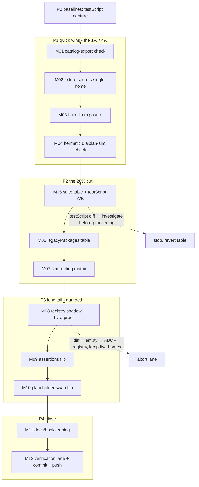

# SUPERB Nix-Native Consolidation Pareto Plan (2026-11-08)

**Status:** ARCHIVED 2026-11-08 — executed the same day it was cut; every
Step-2 row carries its inline verdict below (Step-3 fine rows stay bare
by the inheritance-note convention). M09+M10 landed as one commit (the
stage-3 swap rode the registry commit itself); the plan's drvPath
constraint #4 was proven WRONG in execution — see the M05 verdict.

**Scope.** The six nix-native opportunities surfaced by the 2026-11-08 review
session ("Nix is a programming language — derive repeated structure from
data"), turned into an executable train. NO product behavior changes; this is
maintainability + gate coverage + honest-boundary documentation only.

**Inputs verified (Step 0, all grep/read-verified 2026-11-08):**

- flake.nix carries **37 `import ./tests/` wirings**, ~26 byte-identical
  `{ inherit telephonyModule webphonePackage; }` closures plus 4 identical
  `legacyPackages` entries — repeated structure, data-derivable.
- `scripts/export-catalog.py --selftest` (golden test) exists but is wired
  NOWHERE: no `catalog` string in flake.nix checks or `.github/workflows/ci.yml`.
- `packages/telephony-operator/dialplan_sim.py` (CLI:
  `telephony-dialplan-simulate <dir> --dest N [--when T] [--json]`) consumes the
  GENERATED dialplan XML but runs only inside the operator VM suite — no
  hermetic check.
- No `flake.lib` output exists; `modules/freeswitch.nix` is a pure function
  reachable today only through full `nixosSystem` evals.
- The plain/`*File` secret concept lives in five synchronized homes:
  options.nix pairs, default.nix assertions, shared.nix (`gatewaysForFs`
  placeholder swap + `fsSecrets`), the renderers, tests/eval.nix
  placeholder-expects.
- `tests/common.nix` duplicates the fixture password literals
  (`baseTelephony` + the `sip_call` helper string).

**Errata / already-done (do NOT re-dispatch):**

- The catalog RENDERER stays stdlib-Python by hub contract (the hub runner has
  no nix) — Nix owns only the CHECK lane (M01).
- XML generation stays hand-rolled: `lib.generators.toXML` emits an
  element-text dialect, not FreeSWITCH's attribute dialect. Correct as-is.
- eval.nix's PASS/FAIL-string report design stays (grep-at-build keeps the
  all-findings report; module `assertions` remain the native user-facing gate).
- dialplan_sim is NOT a split brain: it parses the same generated XML
  FreeSWITCH serves; no twin implementation exists.
- Gate scripts (markers/lock-guard/doc-counts) need `.git`; their
  `runCommand` + `${self}` wiring is already the native shape.

## Lane constraints (rules of engagement)

1. **The CI main gate is RED at plan time** (2026-11-08 00:20 report: infra-kill
   class + the textagent 503 assert; healing is owned by the standing TODO rows,
   NOT this train). Every task here verifies via targeted lanes:
   `nix build -L .#checks.<system>.<name>` and `nix eval` probes. Nothing in
   this train claims an airtight-green verdict; the full re-proof stays the
   existing TODO row's job.
2. **Auto-commit daemon shares this tree**: gate FIRST after every nix/python
   edit (`nix fmt` + eval immediately); capture exit codes (`echo EXIT=$?`);
   every verdict-bearing commit is HAND-AUTHORED.
3. **doc-counts coupling**: adding/removing checks changes the check count —
   update the FEATURES.md count literal in the SAME commit as the check change.
4. **A/B method for the suite-table refactor**: drvPath equality is IMPOSSIBLE
   across flake.nix edits (the flake source is an input to every derivation).
   The honest invariant is `testScript` string equality per suite (it is
   source-hash-independent) plus attrNames set equality. Prove THAT.
5. ** Verschlimmbessern guard**: the only risky train is M08–M10 (secret
   registry). It lands as a staged byte-identity proof (shadow attr ==
   current outputs at eval) BEFORE any consumer flips; abort-on-diff keeps the
   current five homes untouched if equality fails.

## Pareto breakdown

- **The 1% that delivers 51%** — M01 (wire the catalog golden selftest; closes
  the only genuinely missing gate) + M02 (single-home the fixture secrets;
  removes a mid-VM failure class). ~1h total, protects existing value
  immediately.
- **The 4% that delivers 64%** — M03 (`flake.lib` exposure; pure addition) +
  M04 (hermetic dialplan-sim check; VM semantics become build-seconds).
  ~1.5h total, one new capability, zero risk to existing suites.
- **The 20% that delivers 80%** — M05+M06 (table-driven suite wiring; ~180
  lines of flake.nix become ~30, suite-adding becomes one line) + M07 (sim
  routing matrix; the new lane earns its keep).
- **The other 20% to 100%** — M08–M10 (secret registry consolidation, staged,
  byte-identity-guarded), M11 (docs/bookkeeping per repo one-home rules),
  M12 (verification lane + hand-authored commits).

## Step 2 — Comprehensive plan (medium granularity, 30–100 min each)

Sorted by importance / impact / effort / customer-value (customer = deployers
of `nixosModules.telephony` + future sessions in this tree).

| #   | Tier | Task                                                                                                                                                                                                                                                                                                                                                                                                                                                                                                     | Impact                 | Effort | Depends on      |
| --- | ---- | -------------------------------------------------------------------------------------------------------------------------------------------------------------------------------------------------------------------------------------------------------------------------------------------------------------------------------------------------------------------------------------------------------------------------------------------------------------------------------------------------------- | ---------------------- | ------ | --------------- |
| M01 | 1%   | Wire `checks.catalog-export` (runCommand running `export-catalog.py --selftest`, `PYTHONPATH = ${./scripts}`); bump the FEATURES check-count literal; build the check **→ done -- check wired + selftest green in-sandbox; count 47→48, doc-counts green (f4b7cc7)**                                                                                                                                                                                                                                     | High (missing gate)    | 30min  | —               |
| M02 | 1%   | Single-home `tests/common.nix` fixture secrets: hoist extension/ES passwords to `let` bindings, interpolate `baseTelephony` + `sip_call`; grep proves zero remaining literals **→ done -- 1 hit per literal; webphone suite testScript byte-identical A/B; dialplan VM suite green (405b6a9)**                                                                                                                                                                                                           | Medium                 | 30min  | —               |
| M03 | 4%   | Expose `flake.lib.telephony.mkFreeSwitchConfig = import ./modules/freeswitch.nix`; prove by calling it with fixture attrs from `nix eval --expr`; CHANGELOG Added entry **→ done -- PROOF_OK eval renders the bridge verbatim (4a843a3)**                                                                                                                                                                                                                                                                | Medium                 | 30min  | —               |
| M04 | 4%   | Hermetic `checks.dialplan-sim`: symlink stage of a fixture eval's `dialplan/*.xml` store paths + 3 assertions (group bridge, echo, after-hours transfer via `--when`); FEATURES count **→ done -- three lanes green via flake.lib fixture; count 48→49 (065082b)**                                                                                                                                                                                                                                       | High (VM→seconds)      | 60min  | M03 optional    |
| M05 | 20%  | Table-driven VM suites in flake.nix: capture per-suite `testScript` baseline, build `plainSuites`/`specialSuites` tables preserving every per-suite comment, swap in, prove attrNames + testScript byte-equality **→ done, method upgraded -- constraint #4 was WRONG: vm-test drvPaths are value-level and STABLE under flake.nix edits, so the A/B proved full drvPath byte-equality (31/31 suites) instead of testScript equality; only the 7 self-embedding derivations moved, by design (919388d)** | High (maintainability) | 90min  | —               |
| M06 | 20%  | Same table treatment for the four `legacyPackages` entries (browser, demo-wallclock, passkey, theme) with testScript A/B **→ done -- attrNames + 4/4 drvPaths byte-identical (4336c37)**                                                                                                                                                                                                                                                                                                                 | Medium                 | 60min  | M05             |
| M07 | 20%  | dialplan-sim routing matrix: DID→public transfer, `toll_allow` international gate (`--no-default-vars`), IVR follow (`--ivr-input`), conference pin path **→ done -- all four lanes asserted; IVR row records the input honestly (menu routing is ivr.conf.xml runtime territory, not a sim-fabricated route) (b3f5b3b)**                                                                                                                                                                                | Medium                 | 45min  | M04             |
| M08 | tail | Secret registry stage 1: registry table in shared.nix (name → plain/file/token/target) + SHADOW derivations of assertions and `fsSecrets`; eval-prove shadow == current (abort-on-diff) **→ done, design refined -- no shadow attrsets needed: fsPlaceholder + exactlyOneSecret own the contract, consumers derive in place, the captured probe IS the shadow (XML surfaces + assertion fingerprints byte-identical, abort-on-diff never tripped) (fd95d09)**                                            | High long-term         | 60min  | M05 (tree calm) |
| M09 | tail | Registry stage 2: flip default.nix assertions to the registry derivation; eval.nix negative arms (both-set / neither-set) still reject **→ done -- four predicates consume exactlyOneSecret; telephony-eval EXIT=0 (e147bd8)**                                                                                                                                                                                                                                                                           | Medium                 | 45min  | M08 green       |
| M10 | tail | Registry stage 3: flip the `gatewaysForFs` placeholder swap + eval placeholder-expects to registry tokens; `telephony-eval` + `telephony-secrets` targeted builds green **→ done, scope honestly reduced -- the swap flip rode the registry commit (M08); eval.nix KEEPS its literal needles by design (independent verifier, not a consumer); telephony-secrets full VM green over registry-derived tokens (e147bd8)**                                                                                  | Medium                 | 45min  | M09 green       |
| M11 | tail | Bookkeeping per one-home rules: CHANGELOG entries per landed train, AGENTS.md knowledge rows (catalog check, sim lane, flake.lib, suite table, registry), TODO_LIST row status sync **→ done -- plus the drvPath-correction knowledge row and a doc_counts docstring staleness fix; TODO row closes with the train's final commit (207b028)**                                                                                                                                                            | Medium                 | 30min  | M01–M10         |
| M12 | tail | Verification lane + close: `nix flake check --no-build` eval sanity, budgeted `check-vm` run of the touched fast suites, hand-authored verdict commit(s), push **→ done -- flake check --no-build --all-systems (eval cache off) EXIT=0; check-vm telephony-monitoring green (telephony-dialplan green at M02); this archive commit + push**                                                                                                                                                             | High (process)         | 30min  | M11             |

Total: ~9h. Every M ends gate-first (fmt + eval) and carries its own commit.

## Step 3 — Fine breakdown (max 12 min active each)

Sorted by importance/impact/effort within execution order. "BG" = kick off in
background, collect later (long builds are not active work).

| #   | Task (≤12min)                                                                                                     | Belongs | Verify by                              |
| --- | ----------------------------------------------------------------------------------------------------------------- | ------- | -------------------------------------- |
| F01 | Run `python3 scripts/export-catalog.py --selftest` locally; capture exit                                          | M01     | EXIT=0                                 |
| F02 | Add `checks.catalog-export` runCommand (PYTHONPATH=${./scripts})                                                  | M01     | nix eval attr present                  |
| F03 | Build the check: `nix build -L .#checks.<sys>.catalog-export`                                                     | M01     | build green                            |
| F04 | Bump FEATURES.md check-count literal; rebuild doc-counts                                                          | M01     | doc-counts green                       |
| F05 | Hoist `ext1000`/`ext1001`/`esPass` let bindings in tests/common.nix                                               | M02     | eval ok                                |
| F06 | Interpolate into `sip_call`; grep proves zero password literals left                                              | M02     | grep empty                             |
| F07 | `nix fmt` + `nix eval .#checks.<sys>.telephony-webphone.testScript` (change-sane)                                 | M02     | eval ok                                |
| F08 | BG run `nix build -L .#checks.<sys>.telephony-dialplan`; collect                                                  | M02     | suite green                            |
| F09 | Add `flake.lib.telephony.mkFreeSwitchConfig` to flake.nix                                                         | M03     | nixfmt clean                           |
| F10 | Prove: `nix eval --expr` call with tls-mode-host-shaped attrs; assert dialplan XML contains the ring-group bridge | M03     | marker present                         |
| F11 | CHANGELOG [Unreleased] Added entry (flake.lib)                                                                    | M03     | headings gate ok                       |
| F12 | In checks/dialplan-sim: pull fixture configDir `dialplan/*.xml` store paths                                       | M04     | eval strings                           |
| F13 | runCommand symlink stage dir + one smoke `telephony-dialplan-simulate` call                                       | M04     | human-readable route                   |
| F14 | Assert 2000 @09:00 bridges members; 9196 hits echo                                                                | M04     | grep route outcome                     |
| F15 | Assert 2000 @21:30 transfers to after-hours destination (`--when`)                                                | M04     | grep transfer                          |
| F16 | FEATURES count bump + fmt + build the new check                                                                   | M04     | green                                  |
| F17 | Baseline: `nix eval .#checks.<sys> --apply` capturing every suite's testScript to /tmp                            | M05     | file written                           |
| F18 | Build `plainSuites` table (~26 entries), comments preserved at rows                                               | M05     | structural grep: each tests/*.nix once |
| F19 | Build `specialSuites` overrides (tls-turn, ssh, boot-tcg, metal-boot, prod-boot, nat)                             | M05     | same grep                              |
| F20 | Swap tables into `checks`; `nix fmt`                                                                              | M05     | eval ok                                |
| F21 | A/B: attrNames set-equal + per-suite testScript byte-diff vs /tmp baseline                                        | M05     | diff empty                             |
| F22 | Table-ize the 4 legacyPackages entries + testScript A/B (2 have none — assert nodes/type equal instead)           | M06     | diff empty                             |
| F23 | Sim matrix: DID → public-context transfer assertion                                                               | M07     | grep                                   |
| F24 | Sim matrix: international dial with `--no-default-vars --var toll_allow=domestic,local` is denied                 | M07     | grep                                   |
| F25 | Sim matrix: IVR entry with `--ivr-input 2` lands at keyed destination                                             | M07     | grep                                   |
| F26 | Sim matrix: conference extension routes to conference app                                                         | M07     | grep                                   |
| F27 | Rebuild check + fmt (count unchanged)                                                                             | M07     | green                                  |
| F28 | shared.nix: registry table rows for eventSocket/extensions/gateways/directory secrets                             | M08     | eval ok                                |
| F29 | Shadow-derive assertions list from registry (NOT wired)                                                           | M08     | eval ok                                |
| F30 | A/B eval: shadow assertions == current assertions (deep equality, --expr)                                         | M08     | equal or ABORT                         |
| F31 | Shadow-derive fsSecrets; A/B equal                                                                                | M08     | equal or ABORT                         |
| F32 | Flip default.nix assertions to registry derivation                                                                | M09     | eval ok                                |
| F33 | Build `telephony-eval` (negative both-set/neither-set arms still reject)                                          | M09     | green                                  |
| F34 | Flip `gatewaysForFs` placeholder swap to registry tokens                                                          | M10     | eval ok                                |
| F35 | Align eval.nix placeholder-expects derivation with registry                                                       | M10     | eval ok                                |
| F36 | BG build `telephony-secrets` + `telephony-eval`; collect                                                          | M10     | green                                  |
| F37 | CHANGELOG entries for every landed train (Added/Changed)                                                          | M11     | headings gate                          |
| F38 | AGENTS.md knowledge rows: catalog check, sim lane, flake.lib, suite table, registry                               | M11     | fmt ok                                 |
| F39 | TODO_LIST row status sync (this train's row)                                                                      | M11     | row updated                            |
| F40 | `nix flake check --no-build` eval sanity (per-system)                                                             | M12     | EXIT=0                                 |
| F41 | BG `nix run .#check-vm -- telephony-dialplan telephony-monitoring` budgeted; collect                              | M12     | green, tier-labeled                    |
| F42 | Hand-authored commit(s) with per-lane verdicts; push                                                              | M12     | pushed                                 |

## Execution graph

## Non-goals (hard guardrails)

- No change to generated XML semantics, option interfaces, or service wiring.
- No nativizing of: the catalog renderer (hub runner has no nix), XML
  generation (dialect mismatch), gate scripts (need git), the PASS/FAIL eval
  report shape, the replace-secret splice pattern.
- No new flake inputs, no nixpkgs pin moves, no lock traffic (lock-guard lane
  untouched).
- No "improvement" that cannot show its A/B proof or its green targeted build.
